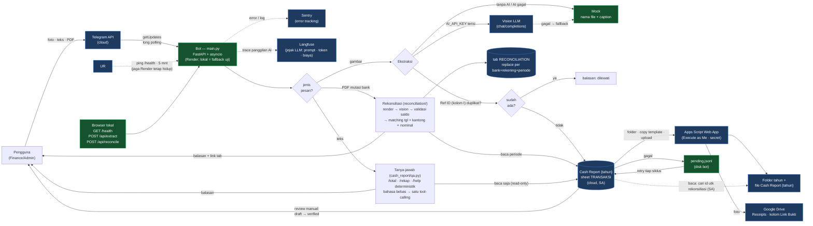

# Bot Pencatatan & Rekonsiliasi Transaksi — Telegram → AI → Cash Report

Bot Telegram terima foto/screenshot bukti transaksi → ekstraksi field → tulis ke **Cash Report** (satu file gabungan per tahun, flat ledger `TRANSAKSI`, RECAP/PnL otomatis, status `draft`, review manual). Tanpa database.

Deploy aktif: https://ai-finance-assistant-z473.onrender.com/health (ringkas di bagian **Men-deploy**; detail operasional di [DEPLOYMENT.md](DEPLOYMENT.md)).

## Arsitektur



- **Routing pesan**: foto → ekstraksi; PDF mutasi → rekonsiliasi; teks → tanya-jawab `/total` `/rekap` `/help` + bahasa bebas via tool-calling. Semua dalam satu proses `main.py` — polling Telegram + endpoint API bersamaan, koneksi **keluar** semua, tanpa server publik.
- Mode vision (AI) dipakai bila `AI_API_KEY` ada; selalu fallback ke mock agar alur tidak pernah putus.
- **Split kredensial**: pembuatan file Drive (folder, copy template, upload foto) = Apps Script Web App; sel/tab Cash Report **dan** baca Drive = service account. `pending.jsonl` = penahan gagal, bukan penyimpanan utama.
- Tanya-jawab **hanya membaca** TRANSAKSI; rekonsiliasi hanya menulis tab RECONCILIATION — tidak pernah mengubah baris transaksi. Error apa pun dilaporkan ke Sentry.
- **Observability ganda**: **Sentry** = error aplikasi; **Langfuse** = jejak tiap panggilan AI (prompt, output JSON, token, biaya, latensi — `vision-extract`, `qa-tool-calling`, `recon-vision`). Langfuse opsional: aktif bila env `LANGFUSE_PUBLIC_KEY`/`LANGFUSE_SECRET_KEY` terisi (SDK v5, endpoint ingestion v4); mati saat pytest. Yang dikirim hanya teks — gambar tidak pernah dikirim.
- Warna: biru = layanan cloud (Telegram/Google/Sentry/Langfuse); hijau = milik bot (proses & file — di Render, atau lokal saat uji).

## Setup

```bash
cd bot
python3 -m venv .venv && source .venv/bin/activate
pip install -r requirements.txt
cp .env.example .env        # lalu isi
python main.py              # server di http://127.0.0.1:8000
```

Isi `.env` minimal:

1. `TELEGRAM_BOT_TOKEN` — dari @BotFather.
2. `TELEGRAM_ALLOWED_CHAT_IDS` — chat_id pengguna yang boleh (cek via @userinfobot), pisahkan koma.

## Setup Google Sheets (service account)

Gratis, tanpa billing, sekali setup (~5 menit), kunci tidak kedaluwarsa.

1. **Buat project** — https://console.cloud.google.com → dropdown project → **New Project** → Create.
2. **Aktifkan API** — menu **APIs & Services** → **Library** → cari "Google Sheets API" → **Enable**.
3. **Buat service account** — **APIs & Services** → **Credentials** → **Create Credentials** → **Service account** → nama bebas → Create and Continue → skip role → **Done**.
4. **Unduh kunci** — klik akun yang baru dibuat → tab **Keys** → **Add Key** → **Create new key** → **JSON**.
5. **Pasang ke project**:
   ```bash
   cp ~/Downloads/<file>.json service_account.json   # sudah masuk .gitignore
   ```
6. **Ambil email service account**:
   ```bash
   .venv/bin/python -c "import json;print(json.load(open('service_account.json'))['client_email'])"
   ```
7. **Siapkan folder Cash Report & share ke SA** — buat folder `Cash Report` di Drive → **Share** → tempel email service account (langkah 6) → role **Editor** → centang "Don't send". *(Semua file yang kelak dibuat di dalamnya — folder tahun, file laporan tahunan — mewarisi izin ini.)*
8. **Isi `.env`**:
   ```
   GOOGLE_SERVICE_ACCOUNT_FILE=service_account.json
   CASH_REPORT_FOLDER_ID=<ID folder Cash Report>
   CASH_REPORT_TEMPLATE_ID=<ID spreadsheet template>
   ```

Verifikasi: `curl http://127.0.0.1:8000/health` → `"sheets": true`.

Troubleshooting: append gagal "insufficient permissions" = email service account (langkah 6) belum dapat akses Editor di folder (langkah 7).

Opsional AI: isi `AI_API_KEY` (+ `AI_BASE_URL`/`AI_MODEL` bila pakai provider lain) untuk ekstraksi vision. Tanpa itu = mode mock (tanggal dari nama file, nominal dari caption).

## Setup Cash Report (folder, template, verifikasi)

Struktur yang dipakai bot:

```
Google Drive/
├── Cash Report/
│   ├── TEMPLATE/
│   │   └── Cash Report TEMPLATE      ← CASH_REPORT_TEMPLATE_ID (dibuat build_template.py)
│   └── <tahun>/                      ← otomatis (folder tahun)
│       └── Cash Report <tahun>       ← otomatis (copy template, mis. "Cash Report 2026")
└── Receipts/                         ← GOOGLE_DRIVE_FOLDER_ID (upload foto)
```

**Template dibangun oleh kode** (gaya Bizschool — tidak perlu membuat manual):

```bash
python cash_report/build_template.py   # sekali jalan -> print id spreadsheet
python cash_report/verify_template.py  # read-only: struktur + formula
```

Isi template (7 sheet, year-agnostic):

| Sheet | Isi |
|---|---|
| SETUP | daftar kantong (BRI, BNI, Jago, UANG KAS) & kategori — master buat AI. Daftar kategori bersumber dari `cash_report/categories.py`, lihat `cash_report/KATEGORI.md` |
| ACCOUNT | saldo awal per kantong (input manual) + Masuk/Keluar (SUMIFS) |
| TRANSAKSI | **flat ledger** — satu-satunya sheet yang ditulis bot |
| RECAP OVERVIEW | rentang periode + pendapatan/pengeluaran/selisih per kategori (SUMIFS, transfer dikecualikan) |
| YEARLY OVERVIEW | arus kas 12 bulan (SUMIFS per bulan) |
| EXPENSE DETAIL | pengeluaran per kategori per bulan + memo COGS (input manual, opsional) |
| INCOME STATEMENT | laba rugi per bulan — turunan RECAP/EXPENSE (SUMIFS) |

Sel periode (`RECAP OVERVIEW!B3`) ditulis bot saat file baru dibuat = `1 Januari <tahun>`; semua sheet lain turunannya. Locale template harus `en_US` — file hasil copy mewarisi locale template, dan rumus berpemisah koma jadi `#ERROR!` bila locale-nya Indonesia; bot memaksa `en_US` pada setiap file baru sebagai pengaman.

Aturan penting:

- **Transfer antar kantong** ditulis **2 baris berpasangan** — keduanya berbagi `Ref ID` yang sama di kolom I (pasangan dikenali dari situ) — saldo tiap kantong akurat, recap/PnL mengecualikannya.
- `Saldo Awal` di ACCOUNT diisi manual sekali per tahun.
- Kolom **Link Bukti (K)** diisi otomatis saat foto terupload ke `Receipts`.

## Setup Google Drive (opsional — arsip bukti transfer)

Foto yang diterima juga diunggah ke Google Drive (folder `Receipts`); tautannya ditulis ke kolom **Link Bukti (K)** supaya bisa dibuka langsung dari Cash Report (memenuhi UC-02). Fitur ini **opsional** — tanpa konfigurasi, bot tetap jalan normal.

**Kenapa Apps Script?** Service account tidak bisa membuat file (kuota 0, `storageQuotaExceeded`), dan OAuth user status Testing kedaluwarsa tiap 7 hari (`invalid_grant`, terbukti 25 Nov 2026 di Sentry). Apps Script Web App berjalan sebagai akun pemilik **tanpa token yang kedaluwarsa** — sekali deploy, selesai. Pembagian kerja:

- **Apps Script** (`apps_script/Code.gs`) — hanya 4 aksi pembuat file: `folder` (cari/buat folder tahun), `copy_template` (copy template tahunan, `LockService` anti ganda), `upload` (foto bukti), `create_sheet` (bootstrap TEMPLATE).
- **Service account** — semua operasi sel/tab (baca tulis TRANSAKSI, RECAP, dll) **dan** baca Drive (cari id spreadsheet untuk rekonsiliasi; scope `drive` penuh, tidak pernah kedaluwarsa).

1. **Buat Web App** — buka [script.google.com](https://script.google.com) → **New project** → tempel seluruh isi `apps_script/Code.gs`.
2. **Set secret** — Project Settings ⚙️ → **Script Properties** → add → `SECRET` = nilai rahasia buatan sendiri (contoh: `openssl rand -hex 24`).
3. **Deploy** — **Deploy → New deployment → Web app** → *Execute as*: **Me** · *Who has access*: **Anyone** → Deploy → salin **Web app URL** (berakhiran `/exec`).
4. **Buat folder tujuan** — di Drive akun pemilik, mis. `Receipts 2026` → salin **Folder ID** dari URL `drive.google.com/drive/folders/`**`ID`**.
5. **Isi `.env`**:
   ```
   APPS_SCRIPT_URL=<web app URL langkah 3>
   APPS_SCRIPT_SECRET=<nilai SECRET langkah 2>
   GOOGLE_DRIVE_FOLDER_ID=<folder id langkah 4>
   ```
   Di Render: sama di Dashboard Environment → restart. Hapus env lama `GOOGLE_OAUTH_*` bila masih ada.
6. **Test cepat** (lokal):
   ```bash
   python -c "import main; print(main._find_or_create_folder('2026', main.CR_FOLDER_ID))"
   ```

Verifikasi: `/health` → `"drive": true`; kirim foto → balasan ada tautan "Bukti transfer" dan baris Cash Report punya isi kolom Link Bukti.

Catatan: unggahan hanya terjadi untuk baris **baru** (duplikat dilewati), dan hanya bila tulis Cash Report sukses. Gagal unggah Drive tidak mematikan proses — kolom dibiarkan kosong, error muncul di log, dan `pending.jsonl` tetap menjadi jaring pengaman. Kalau Apps Script menolak (`secret salah`), cek kecocokan `APPS_SCRIPT_SECRET` dengan Script Properties; kalau `HTTP 403/404`, deploy ulang dengan akses **Anyone**.

## Men-deploy

- **Platform**: Render (free tier — dapat tertidur; UptimeRobot mem-ping `/health` tiap 5 menit agar tetap hidup).
- Connect repo GitHub ini ke Render sebagai Web Service → Build: `pip install -r requirements.txt`; Start: `python main.py` (host/port dari env).
- **Secrets**: semua variabel yang disebut di Setup di atas (`TELEGRAM_BOT_TOKEN`, `TELEGRAM_ALLOWED_CHAT_IDS`, `GOOGLE_SERVICE_ACCOUNT_JSON`/`_FILE`, `CASH_REPORT_FOLDER_ID`/`_TEMPLATE_ID`, `AI_API_KEY`/`AI_BASE_URL`/`AI_MODEL`, `APPS_SCRIPT_URL`/`APPS_SCRIPT_SECRET`, `GOOGLE_DRIVE_FOLDER_ID`, `BNI`/`BRI`/`JAGO_ACCOUNT_NUMBER`, opsional `LANGFUSE_*`, `SENTRY_DSN`) — diisi di Dashboard Render → Environment; tidak pernah di-commit.
- Merge ke `main` → Render deploy otomatis; cek `/health` produksi setelahnya.

## Struktur project

| Berkas/Folder | Fungsi |
|---|---|
| `main.py` | satu-satunya proses: polling Telegram + server FastAPI + ekstraksi + penulis Cash Report + routing QA/rekonsiliasi |
| `cash_report/categories.py` | **sumber tunggal daftar kategori** (prompt AI, dropdown, normalizer) |
| `cash_report/qa.py` | tanya-jawab: tool baca-saja + tool-calling LLM |
| `cash_report/build_template.py`, `verify_template.py`, `verify_setup.py` | bangun & verifikasi template Cash Report (sekali jalan) |
| `reconciliation/` | modul rekonsiliasi PDF mutasi: render, vision, validasi saldo, matching, penulis tab RECONCILIATION |
| `apps_script/Code.gs` | Web App Apps Script — 4 aksi pembuat file Drive (folder, copy template, upload foto, bootstrap) |
| `ai_trace.py` | pelacak panggilan LLM ke Langfuse (opsional, no-op tanpa env) |
| `sentry_setup.py` | inisialisasi Sentry (opsional, no-op tanpa DSN) |
| `tests/` | pytest (31 test: antrean pending, rekonsiliasi, QA, kategori, ai_trace) |
| `samples/` | PDF mutasi bank simulasi untuk uji/demo rekonsiliasi |
| `requirements.txt` | dependensi Python 3.12 |

## Pengaturan batas pemakaian

Tidak ada kuota yang dikelola kode — pengaman berupa **saklar**: kosongkan `AI_API_KEY` → mode mock (nol panggilan AI); kosongkan env Langfuse/Sentry → pelaporan mati. Volume bersifat chat-per-chat: satu panggilan AI per foto/PDF/pertanyaan bebas, tanpa pekerjaan latar berulang. `LANGFUSE_*`/`SENTRY_DSN` kosong aman untuk pytest.

## Cara menggunakan

1. Chat bot di Telegram dari chat yang terdaftar di `TELEGRAM_ALLOWED_CHAT_IDS`.
2. Kirim **satu foto bukti dalam satu pesan** + caption opsional (`Rp195.000 penjualan satvika`) → bot membalas status pencatatan + tautan bukti di Drive.
3. Kirim bukti yang sama lagi → dibalas "sudah tercatat" (dedupe Ref ID), tanpa baris baru.
4. Kirim **PDF mutasi bank** → tab RECONCILIATION diisi hasil pencocokan.
5. Tanya buku: `/total Nov`, `/rekap Nov`, atau bahasa bebas ("berapa pengeluaran November kategori Listrik?").
6. Reviewer membuka Cash Report di Sheets → koreksi bila perlu → ubah `Status` dari `draft` ke `verified` → RECAP/PnL langsung menghitung ulang.

Detail perilaku di balik langkah-langkah itu:

- Kirim **foto ke bot dalam satu pesan**, dengan caption (opsional, mis. `Rp195.000 penjualan satvika`). Caption dipakai sebagai konteks ekstraksi **dan digabung ke Keterangan** (`hasil LLM — caption`, bila keduanya berbeda).
  - Caption yang dikirim sebagai pesan terpisah **tidak** terbaca bot — selalu satu paket foto + caption.
- Mode vision (AI): gambar + caption dikirim bersama ke AI → field diisi AI (`bank` = **kantong asal** BRI/BNI/Jago/UANG KAS; transfer menghasilkan `arah=transfer` + `kantong_tujuan`; kosong → `CR_DEFAULT_BANK` — balasan draft menambah peringatan ⚠️ supaya reviewer sadar).
- Mode mock (tanpa AI): gambar tidak dibaca; tanggal dari nama file, nominal/arah dari caption, keterangan = caption.
- Ack instan sesuai latensi: foto → **"⏳ Membaca bukti transaksi…"**, PDF mutasi → **"⏳ Memproses mutasi bank…"**; teks cukup indikator typing (command membalas <2 detik, tanpa teks ack).
- Bot ekstrak → **pipeline Cash Report**: folder tahun (buat bila perlu) → file `Cash Report <tahun>` (copy template bila baru + tulis sel periode) → sheet `TRANSAKSI` → cek duplikat (Ref ID, kolom I) → upload foto ke Receipts → tulis baris A–K (transfer = 2 baris berpasangan, Ref ID sama) → balasan status + tautan bukti.
- Sheet `TRANSAKSI` tidak ada (template salah) atau tulis gagal → antre `pending.jsonl`, retry otomatis tiap siklus polling — sukses retry dinotifikasikan ke chat asal; gagal diberi tahu sekali (anti-spam).
- Review: ubah kolom `Status` (G) `draft` → `verified` setelah dicek. **Angka AI belum dipakai sebelum verified.** Saat mengoreksi kantong (mis. dari `UANG KAS` default ke `BRI`), **rapikan juga kolom Catatan** — catatan lama `(kantong tidak terbaca — pakai default)` tetap tertinggal dan membingungkan.

## Skema kolom sheet TRANSAKSI (A–K)

Flat ledger — baris 1 header, data mulai baris 2, append di baris pertama kolom A kosong:

| Kolom | Isi | Aturan |
|---|---|---|
| A Tanggal | tanggal transaksi | format tampilan `d-mmm-yy` (format bawaan sel); validasi tanggal |
| B Kantong | BRI / BNI / Jago / UANG KAS | dari ekstraksi (`bank`), fallback `CR_DEFAULT_BANK`; dropdown dari SETUP |
| C Masuk | nominal | terisi bila arah = masuk (atau sisi tujuan transfer) |
| D Keluar | nominal | terisi bila arah = keluar (atau sisi asal transfer) |
| E Kategori | daftar di sheet SETUP (sumber: `cash_report/categories.py`) | dari ekstraksi, dinormalkan ke nama baku; reviewer boleh koreksi |
| F Keterangan | hasil ekstraksi LLM, caption digabung dengan ` — ` bila berbeda | reviewer boleh rapikan |
| G Status | `draft` saat tulis; reviewer → `verified` | dropdown draft/verified |
| H Catatan | catatan sistem (bukan LLM): "wajib ditinjau", nilai tidak terbaca, anomali | |
| I Ref ID | dedupe (`tg:<file_id>` / `manual:…`) — identitas = **konten file**: rename diabaikan, kompres ulang dianggap bukti baru (jaring review `draft`; rencana `doc:` di Pengembangan Berikutnya) | pasangan transfer memakai Ref ID sama |
| J Sumber File | nama file foto asli dari Telegram | |
| K Link Bukti | tautan foto di Drive (kosong bila fitur off/gagal) | |

- **Transfer antar kantong**: `arah=transfer` + `kantong_tujuan` → bot menulis **2 baris** (asal di D, tujuan di C) dengan **Ref ID (I) sama** — itulah penanda pasangannya; RECAP/PnL mengecualikan kategori `Transfer Antar Bank`, ACCOUNT tetap menghitungnya (saldo per kantong benar).
- **Catatan diisi kode, bukan LLM** — contoh: `Ekstraksi AI — wajib ditinjau… (nominal tidak terbaca — isi manual)`, `Mock ekstraksi:…`, `[… transfer tanpa kantong tujuan terbaca …]`.
- Angka resmi dihitung dari baris `Status = verified` (RECAP/PnL) dan memakai C/D sebagai angka; QA menyebut hasil `verified` dan `draft` terpisah.

## Endpoint

- `GET /health` — status telegram/sheets/ai/drive/sentry + antrean.
- `POST /api/extract` `{filename, image_base64?, caption?}` — ekstraksi + tulis Cash Report tanpa bot (untuk uji cepat/web nanti).
- `POST /api/reconcile` `{filename?, pdf_base64}` — rekonsiliasi PDF mutasi bank tanpa Telegram (lihat **Rekonsiliasi Mutasi**).

## Antrean Gagal (`pending.jsonl`)

Mekanisme agar ekstraksi tidak hilang ketika Drive/Sheets tidak bisa dijangkau:

1. **Kapan masuk antrean** — `write_cash_report()` gagal (folder/template tidak ada, permission salah, kredensial kedaluwarsa, koneksi putus) setelah ekstraksi sukses. Record ditulis ke `pending.jsonl` (1 baris JSON per kejadian) lalu pengguna tetap diberi balasan bahwa ekstraksi berhasil tapi pengiriman ditunda.
2. **Format baris** — hasil ekstraksi lengkap (`tanggal`, `keterangan`, `nominal`, `arah`, `bank`, `ref_id`, `catatan`, dst.) + `_error` (pesan kegagalan) + `_ts` (epoch).
3. **Kapan dikirim ulang** — `flush_pending()` dipanggil **tiap siklus polling** sebelum `getUpdates` berikutnya. Seluruh file dibaca dulu, lalu tiap baris dicoba ditulis; baris yang gagal (dan baris JSON rusak — dipertahankan apa adanya, bukan fatal) ditulis ulang bersama sisanya; bila antrean kosong, filenya dihapus agar `/health` melaporkan `pending=false`. Sukses/duplikat → baris hilang dari antrean. Retry **diberi notifikasi** ke chat asal (`chat_id` tersimpan di record): sukses → "✅ berhasil tercatat", gagal → peringatan **sekali saja** (flag `_notif`) agar siklus otomatis tidak jadi spam.
4. **Tidak pernah menggandakan** — retry melewati cek dedupe `Ref ID` (kolom I) yang sama seperti proses normal, jadi meski baris sempat terkirim sebelum error, retry akan berstatus `dup`. Retry **tanpa gambar** (file foto tidak ikut antrean) → kolom Link Bukti kosong — cukup isi manual atau kirim ulang foto untuk baris yang belum ada.
5. **Batas** — file di filesystem proses; **hilang saat redeploy Render** (tidak persisten). Antrean ini penahan kegagalan sementara, bukan penyimpanan. `GET /health` menampilkan `pending: true/false`.

`pending.jsonl` sudah masuk `.gitignore` — tidak pernah ikut ter-commit.

## Tanya-jawab

Routing: foto/dokumen → jalur ekstraksi (tidak pernah lewat LLM); teks → command `/` dulu (deterministik, gratis), lalu bahasa bebas lewat **satu panggilan LLM tool-calling** (modul `cash_report/qa.py`).

- `/total [bulan]` — total masuk/keluar, **default bulan berjalan** (contoh: `/total Nov`, `/total 2026-11`)
- `/rekap [bulan]` — rincian per kategori (default bulan ini)
- `/help` — bantuan; pertanyaan bebas, mis. `"berapa pengeluaran November kategori Listrik?"`

Aturan main: tool **baca-saja** (`aggregate`, `list_rows`, `get_receipt`); angka dihitung kode, LLM hanya merangkai kalimat dan wajib menyebut sumber (periode + TRANSAKSI). Angka **verified dan draft disebut terpisah**, termasuk rincian transfer; transfer antar kantong dikecualikan dari total (konsisten dengan RECAP). Tanpa `AI_API_KEY` atau AI gagal → balasan bantuan; **tidak ada env baru, tidak ada database**.

## Rekonsiliasi Mutasi

Kirim **file PDF mutasi bank** (BNI/BRI/Jago) ke bot, atau `POST /api/reconcile` (`{"pdf_base64": ...}`):

1. PDF dirender per halaman → dibaca vision AI (JSON ketat, retry5xx) → divalidasi keras (total debit/kredit, saldo jalan, saldo akhir).
2. Baris Cash Report periode itu dibaca (UNFORMATTED), cocok dengan kunci **(tanggal, kantong, nominal)** → status `matched` / `bank_only` / `sheet_only` / `needs_review` (dua baris berbagi kunci sama juga jatuh ke `needs_review`).
3. Hasil ditulis ke tab **RECONCILIATION** — periode/bank sama → **diganti** (idempotent), tab TRANSAKSI tidak disentuh. Kolom uang (Debit, Credit, Bank Balance, Sheet Debit, Sheet Credit) otomatis berformat Rupiah tiap kali laporan ditulis.

Butuh env `BNI_ACCOUNT_NUMBER` / `BRI_ACCOUNT_NUMBER` / `JAGO_ACCOUNT_NUMBER` (lihat `.env.example`); butuh `AI_API_KEY`. Catatan: berjalan inline di polling loop — PDF tebal menunda balasan bot lain selama pemrosesan.

## Keterbatasan

- Ekstraksi mock tanpa AI = nominal hanya dari caption (gambar tidak dibaca); tanpa caption, kolom `Nominal` kosong.
- Kategori: mode mock mengosongkannya; mode vision mengisi lalu dinormalkan ke nama baku — ejaan tak dikenal mendarat di kategori `Perlu Ditinjau` (hanya kode boleh memasangnya) dan menunggu koreksi manusia.
- Belum ada hal lain di luar balancing yang tertunda; tanya-jawab dan rekonsiliasi mutasi sudah aktif — lihat bagian **Tanya-jawab** dan **Rekonsiliasi Mutasi**.

## Pengembangan Berikutnya

1. **Balancing (inti Pilihan 1)** — ✅ sebagian (rekonsiliasi): PDF mutasi bank → matching (tanggal, kantong, nominal) → tab RECONCILIATION, lihat **Rekonsiliasi Mutasi**. Sisa: dukungan **mutasi XLSX**, kolom `Status Reconcile` langsung di TRANSAKSI, kunci via nomor referensi dokumen.
2. **Web app baru (rekap/PnL)** — bangun dari awal, membaca Sheet yang sama via service account → rekap harian + draf PnL dari data bot.
3. **Tanya-jawab & ringkasan** — ✅ sudah: command `/total`, `/rekap` + pertanyaan bebas via tool-calling, lihat bagian **Tanya-jawab**.
4. **Kualitas** — pytest: ✅ 31 test (antrean pending, rekonsiliasi/validator, QA, kategori, ai_trace); sisa extract/dedupe; eval 10 foto sampel → bahan EV-xx Testing Report.
5. **Integrasi lanjutan bila waktu cukup** — klasifikasi kategori otomatis ✅ sebagian (vision AI mengisi kategori + normalizer; rule/Jev untuk pemrosesan massal masih terbuka), ekstraksi invoice PDF, multi-kas, deploy always-on.

Yang tidak perlu dibangun: database, login, dashboard analytics, n8n.

## Rancangan Tanya-Jawab & Data (hasil diskusi desain)

Keputusan inti: **tanpa database untuk query AI** — Sheet tetap satu-satunya source of truth.

### Query AI baca Sheet langsung, bukan mirror DB

Data diedit manual di Sheet (draft → verified); mirror DB akan jadi basi dan menimbulkan masalah sync yang justru dihindari. Volume kecil → baca via `gspread` saat query juga cukup. Bentuknya **tools**, bukan database:

| Tool | Fungsi |
|---|---|
| `aggregate(period, arah, kategori?)` | total masuk/keluar — dihitung **kode** |
| `list_rows(period, filter?)` | daftar baris untuk pertanyaan rinci |
| `get_receipt(ref_id)` | ambil tautan foto dari kolom Link Bukti (K) (read-only) |

Aturan tetap: AI hanya menerjemahkan intent → parameter dan menyusun narasi; jawaban wajib menyebut sumber (tab/baris).

### PnL & reconcile: cukup spreadsheet

- **PnL**: baca → agregasi per kategori di kode (sudah dibuktikan prototipe).
- **Reconcile**: matching *in-memory* antara transaksi Sheet dan **tab `Mutasi`** (hasil parse PDF/XLSX disimpan sekali — jangan parse ulang tiap run) → hasil ditulis ke kolom (`Status Reconcile`, `Cocok Dengan`, `Selisih`) + laporan selisih per periode.
- **Database hanya kalau**: butuh log nilai AI vs final (sebelum koreksi vs setelah verifikasi) untuk mengukur akurasi — bahan SC-01/SC-02 & Testing Report — dengan **SQLite** append-only, atau baris > ~100rb / multi-penulis → **PostgreSQL**. Sinkron **satu arah Sheet → DB**, tidak pernah dua arah.

### Routing pesan: foto vs tanya-data

- Foto/dokumen → jalur ekstraksi **tidak berubah** dan tidak pernah melewati LLM (cukup cek tipe pesan).
- Teks → berurutan: (1) command `/` dulu (gratis, deterministik); (2) bahasa bebas → **satu panggilan LLM tool-calling** — pilihan tool-nya *adalah* routing-nya. Classifier terpisah tidak direkomendasikan (berarti dua panggilan AI per pertanyaan: lambat, mahal, dua titik gagal).
- Klasifikasi gagal / AI mati → balasan bantuan (fallback, pola sama dengan mode mock).

### Command `/` — opsional, parameter divalidasi

- Tidak wajib; disarankan untuk pola berulang: `/total Nov`, `/rekap`, `/help`.
- Parameter tidak valid → balas **usage singkat dengan contoh**, tidak pernah exception:
  - `/total` atau `/total abc` → `Format: /total <bulan> — contoh: /total Nov, /total 2026-11`
  - command tidak dikenal → ringkasan bantuan.
- `first = text.split()[0].split("@")[0]` (buang `@botname` di grup) → lookup dict handler → parse argumen di dalam handler.

### Catatan desain (belum diimplementasi)

- **Ref ID prioritas nomor referensi dokumen** — `Ref ID` saat ini selalu diisi `tg:<file_unique_id>` sehingga nomor referensi hasil ekstraksi (`rec["ref"]`) terbuang. Rencana: `ref_id = f"doc:{rec['ref']}"` bila ada, fallback `tg:<file_unique_id>`. Alasan: nomor referensi bank unik per transaksi → deteksi duplikat lebih kuat (foto diedit/kompresi ulang tetap ketangkap) dan menjadi kunci pencocokan untuk balancing terhadap kolom referensi di mutasi bank. Format prefix `doc:`/`tg:` ditentukan sejak awal dan tidak diubah-ubah.
- **Google Drive sebagai penyimpanan bukti transfer** — sudah diimplementasikan (lihat "Setup Google Drive"): folder `Receipts` + kolom Link Bukti (K). Yang belum: **folder per periode** (`Receipts 2026/01`) supaya arsip terpisah per bulan.
- **Nama admin otomatis** — tambah kolom `Nama Admin` diisi dari data pengirim Telegram (`message.from`: `first_name` + `last_name`, fallback `username`, terakhir `"Tidak diketahui"`) — menggantikan kolom "Tanggal Input dan Nama Admin" gaya Cash Report perusahaan. Pertimbangan: nama bergantung pada akun pengirim (bukan selalu orang yang sama dengan yang menginput).
- **Struktur lama (sudah pensiun)** — sebelum gaya Bizschool, bot menulis ke file per bank per tahun dengan tab bulanan + kolom A–P format perusahaan. Struktur itu digantikan file gabungan `Cash Report <tahun>` / sheet `TRANSAKSI` (lihat "Skema kolom"); file lama dibiarkan sebagai arsip historis.

## Catatan data

Berkas di `samples/` adalah PDF mutasi bank **simulasi** untuk uji/demo rekonsiliasi — bukan data nyata. Ledger dan foto bukti sebenarnya tersimpan di Google Sheets/Drive milik pengguna, tidak pernah di repository: jangan mengunggah data keuangan rahasia ke repo ini (`.env`, `service_account.json`, `credentials.json`, `pending.jsonl` sudah dikecualikan lewat `.gitignore`).
