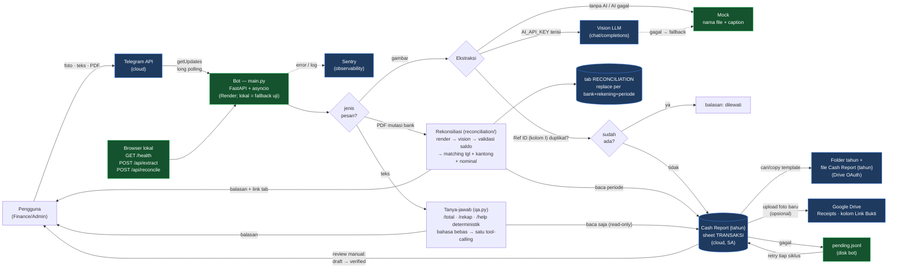

# Bot Pencatatan Transaksi — Milestone 1: Telegram → Ekstraksi → Cash Report

Bot Telegram terima foto/screenshot bukti transaksi → ekstraksi field → tulis ke **Cash Report** (satu file gabungan per tahun, flat ledger `TRANSAKSI`, RECAP/PnL otomatis, status `draft`, review manual). Tanpa database.

Deploy aktif: https://ai-finance-assistant-z473.onrender.com/health — detail di [DEPLOYMENT.md](DEPLOYMENT.md).

## Arsitektur



- **Routing pesan**: foto → ekstraksi (milestone 1); PDF mutasi → rekonsiliasi (milestone 2); teks → tanya-jawab `/total` `/rekap` `/help` + bahasa bebas via tool-calling (milestone 3). Semua dalam satu proses `main.py` — polling Telegram + endpoint API bersamaan, koneksi **keluar** semua, tanpa server publik.
- Mode vision (AI) dipakai bila `AI_API_KEY` ada; selalu fallback ke mock agar alur tidak pernah putus.
- **Split kredensial**: Drive (cari folder, copy template, upload foto) = OAuth user; sel/tab Cash Report = service account. `pending.jsonl` = penahan gagal, bukan penyimpanan utama.
- Tanya-jawab **hanya membaca** TRANSAKSI; rekonsiliasi hanya menulis tab RECONCILIATION — tidak pernah mengubah baris transaksi. Error apa pun dilaporkan ke Sentry.
- Warna: biru = layanan cloud (Telegram/Google/Sentry); hijau = milik bot (proses & file — di Render, atau lokal saat uji).

## Setup

```bash
python3 -m venv .venv && source .venv/bin/activate
pip install -r requirements.txt
cp .env.example .env        # lalu isi
python main.py              # server di http://127.0.0.1:8000
```

Isi `.env` minimal:

1. `TELEGRAM_BOT_TOKEN` — dari @BotFather.
2. `TELEGRAM_ALLOWED_CHAT_IDS` — chat_id pengguna yang boleh (cek via @userinfobot), pisahkan koma.

Untuk menjalankan test dan evaluasi seluruh kriteria keberhasilan (SC-01
sampai SC-07), lihat bagian [Pengujian](#pengujian).

## Setup Google Sheets (service account)

Gratis, tanpa billing, sekali setup (~5 menit), kunci tidak kedaluwarsa.

1. **Buat project** — https://console.cloud.google.com → dropdown project → **New Project** → Create.
2. **Aktifkan API** — menu **APIs & Services** → **Library** → cari "Google Sheets API" → **Enable**.
3. **Buat service account** — **APIs & Services** → **Credentials** → **Create Credentials** → **Service account** → nama bebas → Create and Continue → skip role → **Done**.
4. **Unduh kunci** — klik akun yang baru dibuat → tab **Keys** → **Add Key** → **Create new key** → **JSON**.
5. **Pasang ke project**:
   ```bash
   cp ~/Downloads/<file>.json service_account.json   # sudah masuk .gitignore
   ```
6. **Ambil email service account**:
   ```bash
   .venv/bin/python -c "import json;print(json.load(open('service_account.json'))['client_email'])"
   ```
7. **Siapkan folder Cash Report & share ke SA** — buat folder `Cash Report` di Drive → **Share** → tempel email service account (langkah 6) → role **Editor** → centang "Don't send". *(Semua file yang kelak dibuat di dalamnya — folder tahun, file laporan tahunan — mewarisi izin ini.)*
8. **Isi `.env`**:
   ```
   GOOGLE_SERVICE_ACCOUNT_FILE=service_account.json
   CASH_REPORT_FOLDER_ID=<ID folder Cash Report>
   CASH_REPORT_TEMPLATE_ID=<ID spreadsheet template>
   ```

Verifikasi: `curl http://127.0.0.1:8000/health` → `"sheets": true`.

Troubleshooting: append gagal "insufficient permissions" = email service account (langkah 6) belum dapat akses Editor di folder (langkah 7).

Opsional AI: isi `AI_API_KEY` (+ `AI_BASE_URL`/`AI_MODEL` bila pakai provider lain) untuk ekstraksi vision. Tanpa itu = mode mock (tanggal dari nama file, nominal dari caption).

## Setup Cash Report (folder, template, verifikasi)

Struktur yang dipakai bot:

```
Google Drive/
├── Cash Report/
│   ├── TEMPLATE/
│   │   └── Cash Report TEMPLATE      ← CASH_REPORT_TEMPLATE_ID (dibuat build_template.py)
│   └── <tahun>/                      ← otomatis (folder tahun)
│       └── Cash Report <tahun>       ← otomatis (copy template, mis. "Cash Report 2026")
└── Receipts/                         ← GOOGLE_DRIVE_FOLDER_ID (upload foto)
```

**Template dibangun oleh kode** (gaya Bizschool — tidak perlu membuat manual):

```bash
python cash_report/build_template.py   # sekali jalan -> print id spreadsheet
python cash_report/verify_template.py  # read-only: struktur + formula
```

Isi template (7 sheet, year-agnostic):

| Sheet | Isi |
|---|---|
| SETUP | daftar kantong (BRI, BNI, Jago, UANG KAS) & kategori — master buat AI. Daftar kategori bersumber dari `cash_report/categories.py`, lihat `cash_report/KATEGORI.md` |
| ACCOUNT | saldo awal per kantong (input manual) + Masuk/Keluar (SUMIFS) |
| TRANSAKSI | **flat ledger** — satu-satunya sheet yang ditulis bot |
| RECAP OVERVIEW | rentang periode + pendapatan/pengeluaran/selisih per kategori (SUMIFS, transfer dikecualikan) |
| YEARLY OVERVIEW | arus kas 12 bulan (SUMIFS per bulan) |
| EXPENSE DETAIL | pengeluaran per kategori per bulan + memo COGS (input manual, opsional) |
| INCOME STATEMENT | laba rugi per bulan — turunan RECAP/EXPENSE (SUMIFS) |

Sel periode (`RECAP OVERVIEW!B3`) ditulis bot saat file baru dibuat = `1 Januari <tahun>`; semua sheet lain turunannya.

Aturan penting:

- **Transfer antar kantong** ditulis **2 baris berpasangan** — keduanya berbagi `Ref ID` yang sama di kolom I (pasangan dikenali dari situ) — saldo tiap kantong akurat, recap/PnL mengecualikannya.
- `Saldo Awal` di ACCOUNT diisi manual sekali per tahun.
- Kolom **Link Bukti (K)** diisi otomatis saat foto terupload ke `Receipts`.

## Setup Google Drive (opsional — arsip bukti transfer)

Foto yang diterima juga diunggah ke Google Drive (folder `Receipts`); tautannya ditulis ke kolom **Link Bukti (K)** supaya bisa dibuka langsung dari Cash Report (memenuhi UC-02). Fitur ini **opsional** — tanpa konfigurasi, bot tetap jalan normal.

Upload & manajemen file memakai **OAuth akun user** (bukan service account): Google memblokir service account membuat file sendiri (error `storageQuotaExceeded`). Scope yang dipakai **`https://www.googleapis.com/auth/drive`** (penuh) — diperlukan untuk mencari folder tahun dan menyalin template milik user. **Token lama ber-scopes `drive.file` tidak berlaku untuk fitur ini — buat ulang refresh token (langkah 4).**

1. **Aktifkan Drive API** — Google Cloud Console → **APIs & Services** → **Library** → cari "Google Drive API" → **Enable**.
2. **OAuth consent screen** — **APIs & Services** → **OAuth consent screen** → User Type **External** → isi app name/email → **Save** → tab **Audience/Testing** → **+ Add users** → tambahkan Gmail yang akan jadi pemilik foto (mode Testing cukup, tidak perlu verifikasi Google).
3. **Buat OAuth client** — **Credentials** → **Create Credentials** → **OAuth client ID** → Application type **Desktop app** → Create → **Download JSON** → simpan sebagai `credentials.json` di folder `bot/` (sudah masuk `.gitignore`).
4. **Ambil refresh token (sekali saja)** — jalankan:

```bash
python oauth_init.py
```

   Browser terbuka → login Gmail tujuan → izinkan → salin baris `GOOGLE_OAUTH_REFRESH_TOKEN=...` dari terminal.
5. **Buat folder tujuan** — di Drive akun yang sama, mis. `Receipts 2026` → salin **Folder ID** dari URL `drive.google.com/drive/folders/`**`ID`**. *(Tidak perlu share — file nanti milik akun ini.)*
6. **Isi `.env`**:
   ```
   GOOGLE_OAUTH_CLIENT_ID=<client id dari langkah 3>
   GOOGLE_OAUTH_CLIENT_SECRET=<client secret>
   GOOGLE_OAUTH_REFRESH_TOKEN=<nilai langkah 4>
   GOOGLE_DRIVE_FOLDER_ID=<folder id langkah 5>
   ```
   Di Render: sama di Dashboard Environment.

Verifikasi: `/health` → `"drive": true`; kirim foto → balasan ada tautan "Bukti transfer" dan baris Cash Report punya isi kolom Link Bukti.

Catatan: unggahan hanya terjadi untuk baris **baru** (duplikat dilewati), dan hanya bila tulis Cash Report sukses. Gagal unggah Drive tidak mematikan proses — kolom dibiarkan kosong, error muncul di log. **Refresh token OAuth aplikasi status Testing di Google Cloud kedaluwarsa7 hari** (terbukti25Nov2026: Sentry `invalid_grant: Token has been expired or revoked`). Pemulihan: `python oauth_init.py` lokal → salin refresh token baru → update `GOOGLE_OAUTH_REFRESH_TOKEN` di Environment Render → restart; antrean `pending.jsonl` di-flush otomatis. Supaya tidak berulang tiap minggu: pindahkan aplikasi ke status Production (tanpa review; butuh URL privacy policy/ToS) atau ganti jalur Drive ke Apps Script (Opsi2).

## Alur

- Kirim **foto ke bot dalam satu pesan**, dengan caption (opsional, mis. `Rp195.000 penjualan satvika`). Caption dipakai sebagai konteks ekstraksi **dan digabung ke Keterangan** (`hasil LLM — caption`, bila keduanya berbeda).
  - Caption yang dikirim sebagai pesan terpisah **tidak** terbaca bot — selalu satu paket foto + caption.
- Mode vision (AI): gambar + caption dikirim bersama ke AI → field diisi AI (`bank` = **kantong asal** BRI/BNI/Jago/TUNAI; transfer menghasilkan `arah=transfer` + `kantong_tujuan`; kosong → `CR_DEFAULT_BANK` — balasan draft menambah peringatan ⚠️ supaya reviewer sadar).
- Mode mock (tanpa AI): gambar tidak dibaca; tanggal dari nama file, nominal/arah dari caption, keterangan = caption.
- Bot ekstrak → **pipeline Cash Report**: folder tahun (buat bila perlu) → file `Cash Report <tahun>` (copy template bila baru + tulis sel periode) → sheet `TRANSAKSI` → cek duplikat (Ref ID, kolom I) → upload foto ke Receipts → tulis baris A–K (transfer = 2 baris berpasangan, Ref ID sama) → balasan status + tautan bukti.
- Sheet `TRANSAKSI` tidak ada (template salah) atau tulis gagal → antre `pending.jsonl`, retry otomatis tiap siklus polling.
- Review: ubah kolom `Status` (G) `draft` → `verified` setelah dicek. **Angka AI belum dipakai sebelum verified.** Saat mengoreksi kantong (mis. dari `TUNAI` default ke `BRI`), **rapikan juga kolom Catatan** — catatan lama `(kantong tidak terbaca — pakai default)` tetap tertinggal dan membingungkan.

## Skema kolom sheet TRANSAKSI (A–K)

Flat ledger — baris 1 header, data mulai baris 2, append di baris pertama kolom A kosong:

| Kolom | Isi | Aturan |
|---|---|---|
| A Tanggal | tanggal transaksi | format tampilan `d-mmm-yy` (format bawaan sel) |
| B Kantong | BRI / BNI / Jago / UANG KAS | dari ekstraksi (`bank`), fallback `CR_DEFAULT_BANK` |
| C Masuk | nominal | terisi bila arah = masuk (atau sisi tujuan transfer) |
| D Keluar | nominal | terisi bila arah = keluar (atau sisi asal transfer) |
| E Kategori | daftar di sheet SETUP (sumber: `cash_report/categories.py`) | dari ekstraksi, dinormalkan ke nama baku; reviewer boleh koreksi |
| F Keterangan | hasil ekstraksi LLM, caption digabung dengan ` — ` bila berbeda | reviewer boleh rapikan |
| G Status | `draft` saat tulis; reviewer → `verified` | |
| H Catatan | catatan sistem (bukan LLM): "wajib ditinjau", nilai tidak terbaca, anomali | |
| I Ref ID | dedupe (`tg:<file_id>` / `manual:…`) — identitas = **konten file**: rename diabaikan, kompres ulang dianggap bukti baru (jaring review `draft`; rencana `doc:` di Pengembangan Berikutnya) | pasangan transfer memakai Ref ID sama |
| J Sumber File | nama file foto asli dari Telegram | |
| K Link Bukti | tautan foto di Drive (kosong bila fitur off/gagal) | |

- **Transfer antar kantong**: `arah=transfer` + `kantong_tujuan` → bot menulis **2 baris** (asal di D, tujuan di C) dengan **Ref ID (I) sama** — itulah penanda pasangannya; RECAP/PnL mengecualikan kategori `Transfer Antar Bank`, ACCOUNT tetap menghitungnya (saldo per kantong benar).
- **Catatan diisi kode, bukan LLM** — contoh: `Ekstraksi AI — wajib ditinjau… (nominal tidak terbaca — isi manual)`, `Mock ekstraksi:…`, `[… transfer tanpa kantong tujuan terbaca …]`.
- Query PnL/reconcile nanti **hanya menghitung baris `Status = verified`** dan memakai C/D sebagai angka.

## Endpoint

- `GET /health` — status telegram/sheets/ai/drive + antrean.
- `POST /api/extract` `{filename, image_base64?, caption?}` — ekstraksi + tulis Cash Report tanpa bot (untuk uji cepat/web nanti).
- `POST /api/reconcile` `{filename?, pdf_base64}` — rekonsiliasi PDF mutasi bank tanpa Telegram (lihat **Rekonsiliasi Mutasi**).

## Antrean Gagal (`pending.jsonl`)

Mekanisme agar ekstraksi tidak hilang ketika Drive/Sheets tidak bisa dijangkau:

1. **Kapan masuk antrean** — `write_cash_report()` gagal (folder/template tidak ada, permission salah, kredensial kedaluwarsa, koneksi putus) setelah ekstraksi sukses. Record ditulis ke `pending.jsonl` (1 baris JSON per kejadian) lalu pengguna tetap diberi balasan bahwa ekstraksi berhasil tapi pengiriman ditunda.
2. **Format baris** — hasil ekstraksi lengkap (`tanggal`, `keterangan`, `nominal`, `arah`, `bank`, `ref_id`, `catatan`, dst.) + `_error` (pesan kegagalan) + `_ts` (epoch).
3. **Kapan dikirim ulang** — `flush_pending()` dipanggil **tiap siklus polling** sebelum `getUpdates` berikutnya. Tiap baris dihapus dari file dulu, lalu dicoba tulis; gagal lagi → ditulis ulang. Sukses/duplikat → baris hilang dari antrean.
4. **Tidak pernah menggandakan** — retry melewati cek dedupe `Ref ID` (kolom I) yang sama seperti proses normal, jadi meski baris sempat terkirim sebelum error, retry akan berstatus `dup`. Retry **tanpa gambar** (file foto tidak ikut antrean) → kolom Link Bukti kosong — cukup isi manual atau kirim ulang foto untuk baris yang belum ada.
5. **Batas** — file di filesystem proses; **hilang saat redeploy Render** (tidak persisten). Antrean ini penahan kegagalan sementara, bukan penyimpanan. `GET /health` menampilkan `pending: true/false`.

`pending.jsonl` sudah masuk `.gitignore` — tidak pernah ikut ter-commit.

## Pengujian

Repo ini punya dua lapis pengujian. Yang pertama gratis dan cepat, jadi bisa
dijalankan sesering apa pun. Yang kedua memanggil model berbayar, jadi harus
diminta secara eksplisit.

### Test cepat (gratis, sekitar 1 detik)

```bash
pytest
```

Menjalankan test rumus metrik SC-01, aturan penilaian SC-02, perhitungan waktu
SC-03, perhitungan biaya SC-04, penolakan duplikat SC-05, tata cara runner,
penamaan, serta validasi dataset. Tidak memanggil AI, tidak butuh jaringan, tidak butuh dataset. Ini yang
aman dijalankan di CI.

### Evaluasi kriteria keberhasilan

Kriteria keberhasilan (SC) pada BRD diukur dengan satu set data dan satu runner.
Yang berbeda hanya cara menilainya.

Target di bawah dikutip dari tabel Success Criteria pada BRD bagian 6.

| Kriteria | Yang diukur | Target | Status | Butuh |
|---|---|---|---|---|
| SC-01 | Akurasi usulan kategori | Minimal 85% | sudah | kunci AI |
| SC-02 | Kelengkapan field wajib | Minimal 90% | sudah | kunci AI |
| SC-03 | Waktu proses sampai tersimpan | Rata-rata di bawah 5 detik | sudah | kunci AI + Google Sheets |
| SC-04 | Biaya per gambar | Di bawah Rp50 per gambar | sudah | kunci AI + kurs |
| SC-05 | Bukti berulang tidak mencatat ganda | Seluruh duplikat ditolak | sudah | tidak ada |
| SC-06 | Semua kolom wajib terpetakan | Tidak ada kolom wajib yang hilang | sudah | tidak ada |
| SC-07 | Waktu satu periode vs manual | Di bawah 1 hari kerja | belum, tidak dapat diotomasi | manusia |

SC-01 dan SC-02 mengukur **isi** hasil ekstraksi, jadi bisa dihitung ulang dari
`results_per_row.csv` kapan saja tanpa biaya.

SC-03 dan SC-04 mengukur hal yang **tidak tersimpan** di hasil ekstraksi: durasi
dan jumlah token. Keduanya perlu pengukuran sendiri lebih dulu, dan laporannya
hanya merangkum sampel yang sudah ada.

Persiapan sekali saja:

```bash
cp .env.example .env
# isi AI_API_KEY, dan sesuaikan AI_BASE_URL serta AI_MODEL
python3 tests/sc_runner.py --download     # unduh 65 gambar, sekali saja
```

Menjalankan:

```bash
python3 tests/sc_runner.py                 # semua kriteria (sama dengan --all)
python3 tests/sc_runner.py --sc01          # SC-01 saja
python3 tests/sc_runner.py --sc02          # SC-02 saja
python3 tests/sc_runner.py --sc03          # SC-03 saja
python3 tests/sc_runner.py --sc04          # SC-04 saja
python3 tests/sc_runner.py --sc05          # SC-05 saja
python3 tests/sc_runner.py --sc06          # SC-06 saja
python3 tests/sc_runner.py --download-templates  # unduh template SC-06
python3 tests/sc_runner.py --metrics-only  # hitung ulang tanpa biaya
python3 tests/sc_runner.py --repeat 3      # lihat sebaran antar-run
```

Tanpa flag berarti semua kriteria yang tersedia. Flag kriteria saling
eksklusif, dan menggabungkannya akan ditolak.

Menjalankan perintah yang sama dua kali **tidak** memanggil model lagi pada run
kedua: hasil per gambar disimpan di `sc-out/` dan dilanjutkan dari situ. Runner
mengumumkannya dengan jelas, dan mencatat asal angkanya di `sc-out/source.json`.
Pakai `--restart` untuk benar-benar mengukur ulang dari nol.

### SC-06 membandingkan dengan template perusahaan, bukan daftar salinan

SC-06 memeriksa apakah setiap kolom wajib cash report punya tempat di keluaran
aplikasi. Yang dibandingkan adalah **berkas template perusahaan** di repo
dataset (`Cash Report dan Mutasi Rekening/`), bukan daftar kolom yang ditulis
ulang di kode test.

```bash
python3 tests/sc_runner.py --download-templates   # sekali saja
python3 tests/sc_runner.py --sc06
```

Ketiga berkas template dibaca semuanya, dan header dicari lewat isinya
(`TANGGAL TRANSAKSI`), bukan nomor baris, karena berkas Operasional menaruhnya
di baris 4 sementara yang lain di baris 5.

Setiap kolom wajib punya keputusan tertulis: `langsung` (satu kolom aplikasi),
`diturunkan` (dihitung formula di sheet lain), `terbagi` (diwakili kolom yang
sama lewat pemecahan baris), atau `HILANG`. Keputusan itu ditulis eksplisit di
`MAPPING` supaya bisa diperiksa orang lain, bukan hasil tebakan pencocokan nama.

Satu kolom aplikasi tidak boleh mewakili dua kolom wajib berbeda. Kolom A
aplikasi berisi tanggal transaksi, yang sudah menjadi wakil kolom B perusahaan;
memakainya lagi untuk kolom A perusahaan akan membuat kolom wajib tampak
terpetakan padahal isinya bukan.

### Yang perlu diperiksa saat `main` berubah

Test SC memanggil kode produksi apa adanya, jadi perubahan di `main.py` bisa
membuat pengukuran salah tanpa ada test yang gagal. Tiga hal yang perlu dicek
setiap kali `main` berubah:

1. **Metode worksheet baru.** `write_cash_report` yang memanggil metode baru
   (mis. `ws.format(...)`) akan gagal di worksheet tiruan SC-05. Harness
   menandainya GAGAL DIUKUR, dan
   `test_fake_worksheet_supports_every_method_production_calls` menangkapnya
   lebih dulu.
2. **Panggilan Sheets baru.** Panggilan tambahan di `write_cash_report` harus
   dibungkus di `tests/_sc03_probe.py`, kalau tidak durasinya jatuh ke tahap
   `dedupe` dan laporan SC-03 menyalahkan tahap yang salah.
3. **Prompt ekstraksi.** `tests/_sc04_run.py` menyalin prompt produksi sebagai
   cadangan. Salinan itu harus ikut diperbarui, kalau tidak jumlah token yang
   diukur bukan lagi token produksi.

### SC-03 dan SC-04 perlu pengukuran sendiri

SC-01 dan SC-02 membaca keluaran ekstraksi, jadi menambah kriteria itu tidak
menambah biaya. **SC-03 dan SC-04 berbeda.** Durasi dan jumlah token tidak
tersimpan di `results_per_row.csv`, sehingga tidak bisa dihitung ulang dari
sana. Keduanya punya pengukur sendiri yang harus dijalankan lebih dulu:

```bash
# SC-03: waktu sampai baris tersimpan (butuh Google Sheets)
python3 tests/_sc03_run.py

# SC-04: biaya per gambar (butuh kunci AI dan kurs)
python3 tests/_sc04_run.py --usd-idr 18227
python3 tests/_sc04_run.py --limit 5 --usd-idr 18227    # coba cepat
```

SC-03 menolak berjalan tanpa dua variabel sandbox, dan itu disengaja:

```
SC03_SANDBOX_FOLDER=...     # ID folder Drive khusus uji
SC03_SANDBOX_TEMPLATE=...   # ID spreadsheet template di folder itu
```

Isi keduanya dengan folder **khusus uji**, bukan folder Cash Report perusahaan.
Untuk menyiapkan template 7 tab di folder sandbox, pakai
`python3 tests/_sandbox_build.py`.

Setelah itu `--sc03` dan `--sc04` hanya merangkum sampel yang sudah ada, dan
tidak memanggil model. Kalau sampelnya belum ada, laporannya bilang
`BELUM DIUKUR` beserta perintah yang harus dijalankan.

**SC-03 menulis baris sungguhan ke Google Sheets.** Pengukurannya memakai folder
sandbox terpisah, bukan folder Cash Report perusahaan. Jangan arahkan ke folder
perusahaan.

### SC-05 tidak butuh apa pun

SC-05 menguji bahwa berkas yang dikirim berulang tidak menghasilkan dua baris.
Kriterianya gratis dan tidak butuh kredensial, dataset, maupun jaringan:

```bash
python3 tests/sc_runner.py --sc05
```

Pengukurannya memanggil `handle_update` dan `write_cash_report` dari `main.py`
apa adanya. Yang diganti hanya tiga hal di luar aplikasi: Telegram, Google
Sheets, dan ekstraksi AI. Logika dedup yang dinilai tetap yang sebenarnya.

Karena jalur asli yang dipanggil, tiruan worksheet harus punya **semua** metode
yang dipakai produksi. Bila produksi memakai metode baru, harness menandainya
**GAGAL DIUKUR**, bukan TERCAPAI: kegagalan tulis tidak boleh terbaca sebagai
duplikat yang berhasil ditolak. `test_fake_worksheet_supports_every_method_production_calls`
menjaga hal ini.

Tiga skenario diuji, dan yang ketiga bukan pelengkap:

| Skenario | Harapan |
|---|---|
| Kirim ulang berkas yang sama | ditolak |
| Isi sama, `file_id` berbeda | ditolak menurut BRD, dilaporkan sebagai temuan |
| Gambar berbeda | tetap dicatat |

Skenario ketiga adalah **kendali**. Tanpa itu, dedup yang menolak semua kiriman
akan tampak lulus sempurna padahal merusak aplikasi.

Skenario kedua dilaporkan sebagai **temuan**, bukan dipakai menghukum. BRD
menyebut pengenalan duplikat lewat hash berkas, sedangkan kode memakai identitas
berkas dari Telegram. Selisih itu dicatat apa adanya.

**SC-04 menghitung uang.** Tarif model dan kurs adalah masukannya, dan keduanya
bisa disesuaikan:

```python
# bagian atas tests/sc04_cost.py
PRICE_PROMPT_USD = 0.00000015
PRICE_COMPLETION_USD = 0.0000006
USD_TO_IDR = 0.0        # 0 berarti wajib diisi lewat --usd-idr atau SC04_USD_IDR
TARGET_IDR = 50.0
```

Mengubah tarif atau kurs langsung mengubah laporan tanpa mengukur ulang, karena
biaya selalu diturunkan dari token x tarif x kurs dan tidak pernah disimpan.
Bisa juga ditimpa untuk satu kali jalan tanpa menyunting kode:

```bash
python3 tests/_sc04_run.py --price-prompt 0.0000003 --price-completion 0.0000012 --usd-idr 18227
SC04_USD_IDR=18227 python3 tests/sc_runner.py --sc04
```

Urutan siapa yang menang: argumen CLI, lalu variabel lingkungan, lalu variabel
di kode, lalu katalog penyedia. Tidak ada tarif atau kurs yang ditebak.

Hasil ada di `sc-out/`:

| Berkas | Isi |
|---|---|
| `sc01_report.txt` | SC-01: ringkasan, rincian per kategori, confusion matrix, baris salah |
| `sc01_metrics.json` | SC-01 dalam bentuk JSON |
| `sc02_report.txt` | SC-02: kelengkapan dan kecocokan per field wajib |
| `sc02_metrics.json` | SC-02 dalam bentuk JSON |
| `sc03_report.txt` | SC-03: sebaran waktu dan pecahan per tahap |
| `sc03_metrics.json` | SC-03 dalam bentuk JSON |
| `sc04_report.txt` | SC-04: biaya per gambar dan token |
| `sc04_metrics.json` | SC-04 dalam bentuk JSON |
| `sc05_report.txt` | SC-05: tiap skenario duplikat dan jumlah baris tersimpan |
| `sc05_metrics.json` | SC-05 dalam bentuk JSON |
| `sc06_report.txt` | SC-06: tiap kolom wajib dan nasibnya |
| `sc06_columns.csv` | SC-06: rincian pemetaan per kolom |
| `results_per_row.csv` | Keluaran per gambar, termasuk nominal, tanggal, kantong, arah |
| `sc03_samples.csv` | SC-03: waktu per gambar dan pecahan tahap (bahan laporan SC-03) |
| `sc04_samples.csv` | SC-04: token per gambar (bahan laporan SC-04) |

Dataset tidak disimpan di repo ini karena berisi data keuangan riil perusahaan.
`--download` mengambilnya dari repo dataset terpisah, dan tidak memerlukan token
GitHub. Folder `dataset/` dan `sc-out/` sudah masuk `.gitignore`.

Untuk memaksa evaluasi berjalan sebagai assertion lulus atau gagal terhadap
target BRD, pakai opt-in karena sifatnya berbayar dan lama:

```bash
SC_RUN_MODEL=1 pytest -m sc_model -v
```

Panduan rinci, termasuk jebakan penilaian tiap kriteria dan alasan angka
antar-run berbeda, ada di
[`docs/sc-cara-menjalankan.md`](docs/sc-cara-menjalankan.md).

Hasil pengukuran tiap kriteria:

| Kriteria | Dokumen hasil |
|---|---|
| SC-01 | [`docs/sc01-hasil-evaluasi.md`](docs/sc01-hasil-evaluasi.md) |
| SC-02 | [`docs/sc02-hasil-evaluasi.md`](docs/sc02-hasil-evaluasi.md) |
| SC-03 | [`docs/sc03-hasil-evaluasi.md`](docs/sc03-hasil-evaluasi.md) |
| SC-04 | [`docs/sc04-hasil-evaluasi.md`](docs/sc04-hasil-evaluasi.md) |
| SC-05 | [`docs/sc05-hasil-evaluasi.md`](docs/sc05-hasil-evaluasi.md) |
| SC-06 | [`docs/sc06-hasil-evaluasi.md`](docs/sc06-hasil-evaluasi.md) |
## Tanya-jawab (milestone 3)

Routing: foto/dokumen → jalur ekstraksi (tidak pernah lewat LLM); teks → command `/` dulu (deterministik, gratis), lalu bahasa bebas lewat **satu panggilan LLM tool-calling** (modul `cash_report/qa.py`).

- `/total [bulan]` — total masuk/keluar, **default bulan berjalan** (contoh: `/total Nov`, `/total 2026-11`)
- `/rekap [bulan]` — rincian per kategori (default bulan ini)
- `/help` — bantuan; pertanyaan bebas, mis. `"berapa pengeluaran November kategori Listrik?"`

Aturan main: tool **baca-saja** (`aggregate`, `list_rows`, `get_receipt`); angka dihitung kode, LLM hanya merangkai kalimat dan wajib menyebut sumber (periode + TRANSAKSI). Angka **verified dan draft disebut terpisah**, termasuk rincian transfer; transfer antar kantong dikecualikan dari total (konsisten dengan RECAP). Tanpa `AI_API_KEY` atau AI gagal → balasan bantuan; **tidak ada env baru, tidak ada database**.

## Rekonsiliasi Mutasi (milestone 2)

Kirim **file PDF mutasi bank** (BNI/BRI/Jago) ke bot, atau `POST /api/reconcile` (`{"pdf_base64": ...}`):

1. PDF dirender per halaman → dibaca vision AI (JSON ketat, retry5xx) → divalidasi keras (total debit/kredit, saldo jalan, saldo akhir).
2. Baris Cash Report periode itu dibaca (UNFORMATTED), cocok dengan kunci **(tanggal, kantong, debit, credit)** → status `matched` / `bank_only` / `sheet_only` / `needs_review`.
3. Hasil ditulis ke tab **RECONCILIATION** — periode/bank sama → **diganti** (idempotent), tab TRANSAKSI tidak disentuh.

Butuh env `BNI_ACCOUNT_NUMBER` / `BRI_ACCOUNT_NUMBER` / `JAGO_ACCOUNT_NUMBER` (lihat `.env.example`); butuh `AI_API_KEY`. Catatan: berjalan inline di polling loop — PDF tebal menunda balasan bot lain selama pemrosesan.

## Batasan (milestone 1)

- Ekstraksi mock tanpa AI = nominal hanya dari caption (gambar tidak dibaca); tanpa caption, kolom `Nominal` kosong.
- Klasifikasi awal kosong (kolom Kategori diisi AI bila vision aktif, sisanya manual).
- Belum ada hal lain di luar balancing yang tertunda; tanya-jawab (milestone 3) dan rekonsiliasi mutasi (milestone 2) sudah aktif — lihat bagian **Tanya-jawab** dan **Rekonsiliasi Mutasi**.

## Pengembangan Berikutnya

Urutkan berdasarkan nilai buat brief (3 pilihan kelompok) dan usaha:

1. **Balancing (inti Pilihan 1)** — ✅ sebagian (rekonsiliasi, milestone 2): PDF mutasi bank → matching (tanggal, kantong, nominal) → tab RECONCILIATION, lihat **Rekonsiliasi Mutasi**. Sisa: dukungan **mutasi XLSX**, kolom `Status Reconcile` langsung di TRANSAKSI, kunci via nomor referensi dokumen.
2. **Web app baru (rekap/PnL)** — bangun dari awal, membaca Sheet yang sama via service account → rekap harian + draf PnL dari data bot.
3. **Tanya-jawab & ringkasan** — ✅ sudah (milestone 3): command `/total`, `/rekap` + pertanyaan bebas via tool-calling, lihat bagian **Tanya-jawab**.
4. **Kualitas** — pytest (extract/dedupe/pending), eval 10 foto sampel → bahan EV-xx Testing Report.
5. **Integrasi lanjutan bila waktu cukup** — klasifikasi kategori otomatis (rule/Jev), ekstraksi invoice PDF, multi-kas, deploy always-on.

Yang tidak perlu dibangun: database, login, dashboard analytics, n8n.

## Rancangan Tanya-Jawab & Data (hasil diskusi desain)

Keputusan inti: **tanpa database untuk query AI** — Sheet tetap satu-satunya source of truth.

### Query AI baca Sheet langsung, bukan mirror DB

Data diedit manual di Sheet (draft → verified); mirror DB akan jadi basi dan menimbulkan masalah sync yang justru dihindari. Volume kecil → baca via `gspread` saat query juga cukup. Bentuknya **tools**, bukan database:

| Tool | Fungsi |
|---|---|
| `aggregate(period, arah, kategori?)` | total masuk/keluar — dihitung **kode** |
| `list_rows(period, filter?)` | daftar baris untuk pertanyaan rinci |
| `get_receipt(ref_id)` | ambil tautan foto dari kolom Link Bukti (K) (read-only) |

Aturan tetap: AI hanya menerjemahkan intent → parameter dan menyusun narasi; jawaban wajib menyebut sumber (tab/baris).

### PnL & reconcile: cukup spreadsheet

- **PnL**: baca → agregasi per kategori di kode (sudah dibuktikan prototipe).
- **Reconcile**: matching *in-memory* antara transaksi Sheet dan **tab `Mutasi`** (hasil parse PDF/XLSX disimpan sekali — jangan parse ulang tiap run) → hasil ditulis ke kolom (`Status Reconcile`, `Cocok Dengan`, `Selisih`) + laporan selisih per periode.
- **Database hanya kalau**: butuh log nilai AI vs final (sebelum koreksi vs setelah verifikasi) untuk mengukur akurasi — bahan SC-01/SC-02 & Testing Report — dengan **SQLite** append-only, atau baris > ~100rb / multi-penulis → **PostgreSQL**. Sinkron **satu arah Sheet → DB**, tidak pernah dua arah.

### Routing pesan: foto vs tanya-data

- Foto/dokumen → jalur ekstraksi **tidak berubah** dan tidak pernah melewati LLM (cukup cek tipe pesan).
- Teks → berurutan: (1) command `/` dulu (gratis, deterministik); (2) bahasa bebas → **satu panggilan LLM tool-calling** — pilihan tool-nya *adalah* routing-nya. Classifier terpisah tidak direkomendasikan (berarti dua panggilan AI per pertanyaan: lambat, mahal, dua titik gagal).
- Klasifikasi gagal / AI mati → balasan bantuan (fallback, pola sama dengan mode mock).

### Command `/` — opsional, parameter divalidasi

- Tidak wajib; disarankan untuk pola berulang: `/total Nov`, `/rekap`, `/help`.
- Parameter tidak valid → balas **usage singkat dengan contoh**, tidak pernah exception:
  - `/total` atau `/total abc` → `Format: /total <bulan> — contoh: /total Nov, /total 2026-11`
  - command tidak dikenal → ringkasan bantuan.
- `first = text.split()[0].split("@")[0]` (buang `@botname` di grup) → lookup dict handler → parse argumen di dalam handler.

### Catatan desain (belum diimplementasi)

- **Balasan ack "sedang diproses"** — saat ini foto yang diproses tidak dibalas sampai selesai (ekstraksi bisa 10–60 detik, user menunggu tanpa kabar). Rencana: kirim `⏳ Diterima, sedang diproses…` segera setelah lolos whitelist, **sebelum** unduh file/ekstraksi, lalu pesan hasil seperti sekarang (✅/♻️/⚠️/❌). Kegagalan kirim ack diabaikan agar tidak mematikan proses. Pertimbangan UX: menurunkan risiko user kirim ulang karena mengira gagal, dan memenuhi UN-01 (kepastian transaksi diterima). Bentuk sederhana: dua bubble terpisah; opsi lanjut: edit pesan ack menjadi hasil akhir.
- **Ref ID prioritas nomor referensi dokumen** — `Ref ID` saat ini selalu diisi `tg:<file_unique_id>` sehingga nomor referensi hasil ekstraksi (`rec["ref"]`) terbuang. Rencana: `ref_id = f"doc:{rec['ref']}"` bila ada, fallback `tg:<file_unique_id>`. Alasan: nomor referensi bank unik per transaksi → deteksi duplikat lebih kuat (foto diedit/kompresi ulang tetap ketangkap) dan menjadi kunci pencocokan untuk balancing (milestone 2) terhadap kolom referensi di mutasi bank. Format prefix `doc:`/`tg:` ditentukan sejak awal dan tidak diubah-ubah.
- **Google Drive sebagai penyimpanan bukti transfer** — sudah diimplementasikan (lihat "Setup Google Drive"): folder `Receipts` + kolom Link Bukti (K). Yang belum: **folder per periode** (`Receipts 2026/01`) supaya arsip terpisah per bulan.
- **Nama admin otomatis** — tambah kolom `Nama Admin` diisi dari data pengirim Telegram (`message.from`: `first_name` + `last_name`, fallback `username`, terakhir `"Tidak diketahui"`) — menggantikan kolom "Tanggal Input dan Nama Admin" gaya Cash Report perusahaan. Pertimbangan: nama bergantung pada akun pengirim (bukan selalu orang yang sama dengan yang menginput).
- **Struktur lama (sudah pensiun)** — sebelum gaya Bizschool, bot menulis ke file per bank per tahun dengan tab bulanan + kolom A–P format perusahaan. Struktur itu digantikan file gabungan `Cash Report <tahun>` / sheet `TRANSAKSI` (lihat "Skema kolom"); file lama dibiarkan sebagai arsip historis.
