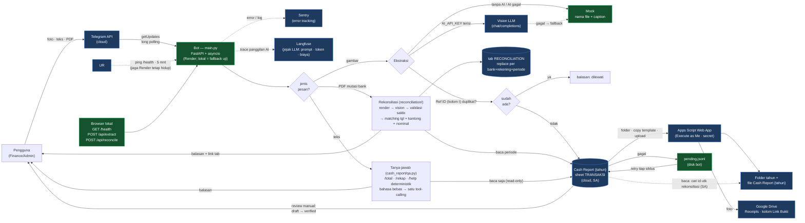

# Bot Pencatatan & Rekonsiliasi Transaksi — Telegram → AI → Cash Report

Bot Telegram terima foto/screenshot bukti transaksi → ekstraksi field → tulis ke **Cash Report** (satu file gabungan per tahun, flat ledger `TRANSAKSI`, RECAP/PnL otomatis, status `draft`, review manual). Tanpa database.

Deploy aktif: https://ai-finance-assistant-z473.onrender.com/health (ringkas di bagian **Men-deploy**; detail operasional di [DEPLOYMENT.md](DEPLOYMENT.md)).

## Arsitektur



- **Routing pesan**: foto → ekstraksi; PDF mutasi → rekonsiliasi; teks → tanya-jawab `/total` `/rekap` `/help` + bahasa bebas via tool-calling. Semua dalam satu proses `main.py` — polling Telegram + endpoint API bersamaan, koneksi **keluar** semua, tanpa server publik.
- Mode vision (AI) dipakai bila `AI_API_KEY` ada; selalu fallback ke mock agar alur tidak pernah putus.
- **Split kredensial**: pembuatan file Drive (folder, copy template, upload foto) = Apps Script Web App; sel/tab Cash Report **dan** baca Drive = service account. `pending.jsonl` = penahan gagal, bukan penyimpanan utama.
- Tanya-jawab **hanya membaca** TRANSAKSI; rekonsiliasi hanya menulis tab RECONCILIATION — tidak pernah mengubah baris transaksi. Error apa pun dilaporkan ke Sentry.
- **Observability ganda**: **Sentry** = error aplikasi; **Langfuse** = jejak tiap panggilan AI (prompt, output JSON, token, biaya, latensi — `vision-extract`, `qa-tool-calling`, `recon-vision`). Langfuse opsional: aktif bila env `LANGFUSE_PUBLIC_KEY`/`LANGFUSE_SECRET_KEY` terisi (SDK v5, endpoint ingestion v4); mati saat pytest. Yang dikirim hanya teks — gambar tidak pernah dikirim.
- Warna: biru = layanan cloud (Telegram/Google/Sentry/Langfuse); hijau = milik bot (proses & file — di Render, atau lokal saat uji).

## Setup

```bash
git clone https://github.com/Project-Rework-G3-AI/ai-finance-assistant.git
cd ai-finance-assistant
python3 -m venv .venv && source .venv/bin/activate
pip install -r requirements.txt
cp .env.example .env        # lalu isi
python main.py              # server di http://127.0.0.1:8000
```

Isi `.env` minimal:

1. `TELEGRAM_BOT_TOKEN` — dari @BotFather.
2. `TELEGRAM_ALLOWED_CHAT_IDS` — chat_id pengguna yang boleh (cek via @userinfobot), pisahkan koma.

## Setup Google Sheets (service account)

Gratis, tanpa billing, sekali setup (~5 menit), kunci tidak kedaluwarsa.

1. **Buat project** — https://console.cloud.google.com → dropdown project → **New Project** → Create.
2. **Aktifkan API** — menu **APIs & Services** → **Library** → cari "Google Sheets API" → **Enable**.
3. **Buat service account** — **APIs & Services** → **Credentials** → **Create Credentials** → **Service account** → nama bebas → Create and Continue → skip role → **Done**.
4. **Unduh kunci** — klik akun yang baru dibuat → tab **Keys** → **Add Key** → **Create new key** → **JSON**.
5. **Pasang ke project**:
   ```bash
   cp ~/Downloads/<file>.json service_account.json   # sudah masuk .gitignore
   ```
6. **Ambil email service account**:
   ```bash
   .venv/bin/python -c "import json;print(json.load(open('service_account.json'))['client_email'])"
   ```
7. **Siapkan folder Cash Report & share ke SA** — buat folder `Cash Report` di Drive → **Share** → tempel email service account (langkah 6) → role **Editor** → centang "Don't send". *(Semua file yang kelak dibuat di dalamnya — folder tahun, file laporan tahunan — mewarisi izin ini.)*
8. **Isi `.env`**:
   ```
   GOOGLE_SERVICE_ACCOUNT_FILE=service_account.json
   CASH_REPORT_FOLDER_ID=<ID folder Cash Report>
   CASH_REPORT_TEMPLATE_ID=<ID spreadsheet template>
   ```

Verifikasi: `curl http://127.0.0.1:8000/health` → `"sheets": true`.

Troubleshooting: append gagal "insufficient permissions" = email service account (langkah 6) belum dapat akses Editor di folder (langkah 7).

Opsional AI: isi `AI_API_KEY` (+ `AI_BASE_URL`/`AI_MODEL` bila pakai provider lain) untuk ekstraksi vision. Tanpa itu = mode mock (tanggal dari nama file, nominal dari caption).

## Setup Cash Report (folder, template, verifikasi)

Struktur yang dipakai bot:

```
Google Drive/
├── Cash Report/
│   ├── TEMPLATE/
│   │   └── Cash Report TEMPLATE      ← CASH_REPORT_TEMPLATE_ID (dibuat build_template.py)
│   └── <tahun>/                      ← otomatis (folder tahun)
│       └── Cash Report <tahun>       ← otomatis (copy template, mis. "Cash Report 2026")
└── Receipts/                         ← GOOGLE_DRIVE_FOLDER_ID (upload foto)
```

**Template dibangun oleh kode** (gaya Bizschool — tidak perlu membuat manual):

```bash
python cash_report/build_template.py   # sekali jalan -> print id spreadsheet
python cash_report/verify_template.py  # read-only: struktur + formula
```

Isi template (7 sheet, year-agnostic):

| Sheet | Isi |
|---|---|
| SETUP | daftar kantong (BRI, BNI, Jago, UANG KAS) & kategori — master buat AI. Daftar kategori bersumber dari `cash_report/categories.py`, lihat `cash_report/KATEGORI.md` |
| ACCOUNT | saldo awal per kantong (input manual) + Masuk/Keluar (SUMIFS) |
| TRANSAKSI | **flat ledger** — satu-satunya sheet yang ditulis bot |
| RECAP OVERVIEW | rentang periode + pendapatan/pengeluaran/selisih per kategori (SUMIFS, transfer dikecualikan) |
| YEARLY OVERVIEW | arus kas 12 bulan (SUMIFS per bulan) |
| EXPENSE DETAIL | pengeluaran per kategori per bulan + memo COGS (input manual, opsional) |
| INCOME STATEMENT | laba rugi per bulan — turunan RECAP/EXPENSE (SUMIFS) |

Sel periode (`RECAP OVERVIEW!B3`) ditulis bot saat file baru dibuat = `1 Januari <tahun>`; semua sheet lain turunannya. Locale template harus `en_US` — file hasil copy mewarisi locale template, dan rumus berpemisah koma jadi `#ERROR!` bila locale-nya Indonesia; bot memaksa `en_US` pada setiap file baru sebagai pengaman.

Tab **RECONCILIATION** tidak termasuk template — ia dibuat otomatis oleh bot saat rekonsiliasi pertama dijalankan untuk file tahun itu (lihat **Rekonsiliasi Mutasi**).

Aturan penting:

- **Transfer antar kantong** ditulis **2 baris berpasangan** — keduanya berbagi `Ref ID` yang sama di kolom I (pasangan dikenali dari situ) — saldo tiap kantong akurat, recap/PnL mengecualikannya.
- `Saldo Awal` di ACCOUNT diisi manual sekali per tahun.
- Kolom **Link Bukti (K)** diisi otomatis saat foto terupload ke `Receipts`.

## Setup Google Drive (opsional — arsip bukti transfer)

Foto yang diterima juga diunggah ke Google Drive (folder `Receipts`); tautannya ditulis ke kolom **Link Bukti (K)** supaya bisa dibuka langsung dari Cash Report (memenuhi UC-02). Fiturnya **sudah terimplementasi** — yang opsional adalah pemasangannya: tanpa konfigurasi Drive, bot tetap jalan normal (kolom Link Bukti kosong, foto tidak diarsip).

**Kenapa Apps Script?** Service account tidak bisa membuat file (kuota 0, `storageQuotaExceeded`), dan OAuth user status Testing kedaluwarsa tiap 7 hari (`invalid_grant`, terbukti 25 Nov 2026 di Sentry). Apps Script Web App berjalan sebagai akun pemilik **tanpa token yang kedaluwarsa** — sekali deploy, selesai. Pembagian kerja:

- **Apps Script** (`apps_script/Code.gs`) — hanya 4 aksi pembuat file: `folder` (cari/buat folder tahun), `copy_template` (copy template tahunan, `LockService` anti ganda), `upload` (foto bukti), `create_sheet` (bootstrap TEMPLATE).
- **Service account** — semua operasi sel/tab (baca tulis TRANSAKSI, RECAP, dll) **dan** baca Drive (cari id spreadsheet untuk rekonsiliasi; scope `drive` penuh, tidak pernah kedaluwarsa).

1. **Buat Web App** — buka [script.google.com](https://script.google.com) → **New project** → tempel seluruh isi `apps_script/Code.gs`.
2. **Set secret** — Project Settings ⚙️ → **Script Properties** → add → `SECRET` = nilai rahasia buatan sendiri (contoh: `openssl rand -hex 24`).
3. **Deploy** — **Deploy → New deployment → Web app** → *Execute as*: **Me** · *Who has access*: **Anyone** → Deploy → salin **Web app URL** (berakhiran `/exec`).
4. **Buat folder tujuan** — di Drive akun pemilik, mis. `Receipts 2026` → salin **Folder ID** dari URL `drive.google.com/drive/folders/`**`ID`**.
5. **Isi `.env`**:
   ```
   APPS_SCRIPT_URL=<web app URL langkah 3>
   APPS_SCRIPT_SECRET=<nilai SECRET langkah 2>
   GOOGLE_DRIVE_FOLDER_ID=<folder id langkah 4>
   ```
   Di Render: sama di Dashboard Environment → restart. Hapus env lama `GOOGLE_OAUTH_*` bila masih ada.
6. **Test cepat** (lokal):
   ```bash
   python -c "import main; print(main._find_or_create_folder('2026', main.CR_FOLDER_ID))"
   ```

Verifikasi: `/health` → `"drive": true`; kirim foto → balasan ada tautan "Bukti transfer" dan baris Cash Report punya isi kolom Link Bukti.

Catatan: unggahan hanya terjadi untuk baris **baru** (duplikat dilewati), dan hanya bila tulis Cash Report sukses. Gagal unggah Drive tidak mematikan proses — kolom dibiarkan kosong, error muncul di log, dan `pending.jsonl` tetap menjadi jaring pengaman. Kalau Apps Script menolak (`secret salah`), cek kecocokan `APPS_SCRIPT_SECRET` dengan Script Properties; kalau `HTTP 403/404`, deploy ulang dengan akses **Anyone**.

## Men-deploy

- **Platform**: Render (free tier — dapat tertidur; UptimeRobot mem-ping `/health` tiap 5 menit agar tetap hidup).
- Connect repo GitHub ini ke Render sebagai Web Service → Build: `pip install -r requirements.txt`; Start: `python main.py` (host/port dari env).
- **Secrets**: semua variabel yang disebut di Setup di atas (`TELEGRAM_BOT_TOKEN`, `TELEGRAM_ALLOWED_CHAT_IDS`, `GOOGLE_SERVICE_ACCOUNT_JSON`/`_FILE`, `CASH_REPORT_FOLDER_ID`/`_TEMPLATE_ID`, `AI_API_KEY`/`AI_BASE_URL`/`AI_MODEL`, `APPS_SCRIPT_URL`/`APPS_SCRIPT_SECRET`, `GOOGLE_DRIVE_FOLDER_ID`, `BNI`/`BRI`/`JAGO_ACCOUNT_NUMBER`, opsional `LANGFUSE_*`, `SENTRY_DSN`) — diisi di Dashboard Render → Environment; tidak pernah di-commit.
- Merge ke `main` → Render deploy otomatis; cek `/health` produksi setelahnya.

## Struktur project

| Berkas/Folder | Fungsi |
|---|---|
| `main.py` | satu-satunya proses: polling Telegram + server FastAPI + ekstraksi + penulis Cash Report + routing QA/rekonsiliasi |
| `cash_report/categories.py` | **sumber tunggal daftar kategori** (prompt AI, dropdown, normalizer) |
| `cash_report/qa.py` | tanya-jawab: tool baca-saja + tool-calling LLM |
| `cash_report/build_template.py`, `verify_template.py`, `verify_setup.py` | bangun & verifikasi template Cash Report (sekali jalan) |
| `reconciliation/` | modul rekonsiliasi PDF mutasi: render, vision, validasi saldo, matching, penulis tab RECONCILIATION |
| `apps_script/Code.gs` | Web App Apps Script — 4 aksi pembuat file Drive (folder, copy template, upload foto, bootstrap) |
| `ai_trace.py` | pelacak panggilan LLM ke Langfuse (opsional, no-op tanpa env) |
| `sentry_setup.py` | inisialisasi Sentry (opsional, no-op tanpa DSN) |
| `tests/` | pytest (31 test: antrean pending, rekonsiliasi, QA, kategori, ai_trace) |
| `samples/` | PDF mutasi bank simulasi untuk uji/demo rekonsiliasi |
| `requirements.txt` | dependensi Python 3.12 |

## Pengaturan batas pemakaian

Tidak ada kuota yang dikelola kode — pengaman berupa **saklar**: kosongkan `AI_API_KEY` → mode mock (nol panggilan AI); kosongkan env Langfuse/Sentry → pelaporan mati. Volume bersifat chat-per-chat: satu panggilan AI per foto/PDF/pertanyaan bebas, tanpa pekerjaan latar berulang. `LANGFUSE_*`/`SENTRY_DSN` kosong aman untuk pytest.

## Cara menggunakan

1. Chat bot di Telegram dari chat yang terdaftar di `TELEGRAM_ALLOWED_CHAT_IDS`.
2. Kirim **satu foto bukti dalam satu pesan** + caption opsional (`Rp195.000 penjualan satvika`) → bot membalas status pencatatan + tautan bukti di Drive.
3. Kirim bukti yang sama lagi → dibalas "sudah tercatat" (dedupe Ref ID), tanpa baris baru.
4. Kirim **PDF mutasi bank** → tab RECONCILIATION diisi hasil pencocokan.
5. Tanya buku: `/total Nov`, `/rekap Nov`, atau bahasa bebas ("berapa pengeluaran November kategori Listrik?").
6. Reviewer membuka Cash Report di Sheets → koreksi bila perlu → ubah `Status` dari `draft` ke `verified` → RECAP/PnL langsung menghitung ulang.

Detail perilaku di balik langkah-langkah itu:

- Kirim **foto ke bot dalam satu pesan**, dengan caption (opsional, mis. `Rp195.000 penjualan satvika`). Caption dipakai sebagai konteks ekstraksi **dan digabung ke Keterangan** (`hasil LLM — caption`, bila keduanya berbeda).
  - Caption yang dikirim sebagai pesan terpisah **tidak** terbaca bot — selalu satu paket foto + caption.
- Mode vision (AI): gambar + caption dikirim bersama ke AI → field diisi AI (`bank` = **kantong asal** BRI/BNI/Jago/UANG KAS; `arah=transfer` **hanya bila penerima tercantum sebagai kantong milik sendiri** — pihak luar (merchant/QRIS/orang lain) = keluar — dan `kantong_tujuan` wajib saat transfer; kosong → `CR_DEFAULT_BANK` — balasan draft menambah peringatan ⚠️ supaya reviewer sadar).
- Mode mock (tanpa AI): gambar tidak dibaca; tanggal dari nama file, nominal/arah dari caption, keterangan = caption.
- Ack instan sesuai latensi: foto → **"⏳ Membaca bukti transaksi…"**, PDF mutasi → **"⏳ Memproses mutasi bank…"**; teks cukup indikator typing (command membalas <2 detik, tanpa teks ack).
- Bot ekstrak → **pipeline Cash Report**: folder tahun (buat bila perlu) → file `Cash Report <tahun>` (copy template bila baru + tulis sel periode) → sheet `TRANSAKSI` → cek duplikat (Ref ID, kolom I) → upload foto ke Receipts → tulis baris A–K (transfer = 2 baris berpasangan, Ref ID sama) → balasan status + tautan bukti.
- Sheet `TRANSAKSI` tidak ada (template salah) atau tulis gagal → antre `pending.jsonl`, retry otomatis tiap siklus polling — sukses retry dinotifikasikan ke chat asal; gagal diberi tahu sekali (anti-spam).
- Review: ubah kolom `Status` (G) `draft` → `verified` setelah dicek. **Angka AI belum dipakai sebelum verified.** Saat mengoreksi kantong (mis. dari `UANG KAS` default ke `BRI`), **rapikan juga kolom Catatan** — catatan lama `(kantong tidak terbaca — pakai default)` tetap tertinggal dan membingungkan.

## Skema kolom sheet TRANSAKSI (A–K)

Flat ledger — baris 1 header, data mulai baris 2, append di baris pertama kolom A kosong:

| Kolom | Isi | Aturan |
|---|---|---|
| A Tanggal | tanggal transaksi | format tampilan `d-mmm-yy` (format bawaan sel); validasi tanggal |
| B Kantong | BRI / BNI / Jago / UANG KAS | dari ekstraksi (`bank`), fallback `CR_DEFAULT_BANK`; dropdown dari SETUP |
| C Masuk | nominal | terisi bila arah = masuk (atau sisi tujuan transfer) |
| D Keluar | nominal | terisi bila arah = keluar (atau sisi asal transfer) |
| E Kategori | daftar di sheet SETUP (sumber: `cash_report/categories.py`) | dari ekstraksi, dinormalkan ke nama baku; reviewer boleh koreksi |
| F Keterangan | hasil ekstraksi LLM, caption digabung dengan ` — ` bila berbeda | reviewer boleh rapikan |
| G Status | `draft` saat tulis; reviewer → `verified` | dropdown draft/verified |
| H Catatan | catatan sistem (bukan LLM): "wajib ditinjau", nilai tidak terbaca, anomali | |
| I Ref ID | dedupe (`tg:<file_id>` / `manual:…`) — identitas = **konten file**: rename diabaikan, kompres ulang dianggap bukti baru (jaring review `draft`; rencana `doc:` di Pengembangan Berikutnya) | pasangan transfer memakai Ref ID sama |
| J Sumber File | nama file foto asli dari Telegram | |
| K Link Bukti | tautan foto di Drive (kosong bila fitur off/gagal) | |

- **Transfer antar kantong**: `arah=transfer` + `kantong_tujuan` → bot menulis **2 baris** (asal di D, tujuan di C) dengan **Ref ID (I) sama** — itulah penanda pasangannya; RECAP/PnL mengecualikan kategori `Transfer Antar Bank`, ACCOUNT tetap menghitungnya (saldo per kantong benar).
- **Catatan diisi kode, bukan LLM** — contoh: `Ekstraksi AI — wajib ditinjau… (nominal tidak terbaca — isi manual)`, `Mock ekstraksi:…`, `[… transfer tanpa kantong tujuan terbaca …]`.
- Angka resmi dihitung dari baris `Status = verified` (RECAP/PnL) dan memakai C/D sebagai angka; QA menyebut hasil `verified` dan `draft` terpisah.

## Endpoint

- `GET /health` — status telegram/sheets/ai/drive/sentry + antrean.
- `POST /api/extract` `{filename, image_base64?, caption?}` — ekstraksi + tulis Cash Report tanpa bot (untuk uji cepat/web nanti).
- `POST /api/reconcile` `{filename?, pdf_base64}` — rekonsiliasi PDF mutasi bank tanpa Telegram (lihat **Rekonsiliasi Mutasi**).

## Antrean Gagal (`pending.jsonl`)

Mekanisme agar ekstraksi tidak hilang ketika Drive/Sheets tidak bisa dijangkau:

1. **Kapan masuk antrean** — `write_cash_report()` gagal (folder/template tidak ada, permission salah, kredensial kedaluwarsa, koneksi putus) setelah ekstraksi sukses. Record ditulis ke `pending.jsonl` (1 baris JSON per kejadian) lalu pengguna tetap diberi balasan bahwa ekstraksi berhasil tapi pengiriman ditunda.
2. **Format baris** — hasil ekstraksi lengkap (`tanggal`, `keterangan`, `nominal`, `arah`, `bank`, `ref_id`, `catatan`, dst.) + `_error` (pesan kegagalan) + `_ts` (epoch).
3. **Kapan dikirim ulang** — `flush_pending()` dipanggil **tiap siklus polling** sebelum `getUpdates` berikutnya. Seluruh file dibaca dulu, lalu tiap baris dicoba ditulis; baris yang gagal (dan baris JSON rusak — dipertahankan apa adanya, bukan fatal) ditulis ulang bersama sisanya; bila antrean kosong, filenya dihapus agar `/health` melaporkan `pending=false`. Sukses/duplikat → baris hilang dari antrean. Retry **diberi notifikasi** ke chat asal (`chat_id` tersimpan di record): sukses → "✅ berhasil tercatat", gagal → peringatan **sekali saja** (flag `_notif`) agar siklus otomatis tidak jadi spam.
4. **Tidak pernah menggandakan** — retry melewati cek dedupe `Ref ID` (kolom I) yang sama seperti proses normal, jadi meski baris sempat terkirim sebelum error, retry akan berstatus `dup`. Retry **tanpa gambar** (file foto tidak ikut antrean) → kolom Link Bukti kosong — cukup isi manual atau kirim ulang foto untuk baris yang belum ada.
5. **Batas** — file di filesystem proses; **hilang saat redeploy Render** (tidak persisten). Antrean ini penahan kegagalan sementara, bukan penyimpanan. `GET /health` menampilkan `pending: true/false`.

`pending.jsonl` sudah masuk `.gitignore` — tidak pernah ikut ter-commit.

## Pengujian

Repo ini punya dua lapis pengujian. Yang pertama gratis dan cepat, jadi bisa
dijalankan sesering apa pun. Yang kedua memanggil model berbayar, jadi harus
diminta secara eksplisit.

### Test cepat (gratis, sekitar 1 detik)

```bash
pytest
```

Menjalankan test rumus metrik SC-01, aturan penilaian SC-02, perhitungan waktu
SC-03, perhitungan biaya SC-04, penolakan duplikat SC-05, tata cara runner,
penamaan, serta validasi dataset. Tidak memanggil AI, tidak butuh jaringan, tidak butuh dataset. Ini yang
aman dijalankan di CI.

### Evaluasi kriteria keberhasilan

Kriteria keberhasilan (SC) pada BRD diukur dengan satu set data dan satu runner.
Yang berbeda hanya cara menilainya.

Target di bawah dikutip dari tabel Success Criteria pada BRD bagian 6.

**SC-01 sampai SC-07 sudah punya pengukur.** SC-08 sudah ditetapkan di BRD,
tetapi **belum punya pengukur**, sehingga belum dapat dijalankan dan belum boleh
ditulis tercapai. Barisnya tetap dicantumkan agar selisih antara BRD dan
pengukur terlihat, bukan tersembunyi.

| Kriteria | Yang diukur | Target | Status | Butuh |
|---|---|---|---|---|
| SC-01 | Akurasi usulan kategori | Minimal 85% | **belum tercapai: 9,2%** | kunci AI |
| SC-02 | Kelengkapan field wajib | Minimal 90% | **tercapai: 93,5%** | kunci AI |
| SC-03 | Waktu proses sampai tersimpan | Rata-rata di bawah 5 detik | **belum tercapai: 10,31 detik** | kunci AI + Google Sheets |
| SC-04 | Biaya per gambar | Di bawah Rp50 per gambar | **tercapai: Rp22,10** | kunci AI + kurs |
| SC-05 | Bukti berulang tidak mencatat ganda | Seluruh duplikat ditolak | **tercapai: 5 dari 5** | tidak ada |
| SC-06 | Pemetaan kolom wajib cash report | Tidak ada kolom wajib yang hilang | **tercapai: 79 dari 79 baris** | template + kunci AI |
| SC-07 | Rekonsiliasi mutasi rekening bank | Saldo akhir sama pada kedua rekening | **belum stabil: 2 dari 4 percobaan selesai** | kunci AI + PDF mutasi |
| SC-08 | Tanya jawab analitik keuangan | Seluruh jawaban sesuai | belum diukur | kunci AI + daftar pertanyaan baku |

SC-01 dan SC-02 membaca hasil ekstraksi, jadi bisa dihitung ulang dari
`results_per_row.csv` kapan saja tanpa biaya.

SC-03 dan SC-04 mengukur hal yang **tidak tersimpan** di hasil ekstraksi: durasi
dan jumlah token. Keduanya perlu pengukuran sendiri lebih dulu, dan laporannya
hanya merangkum sampel yang sudah ada.

SC-07 juga begitu, dan ada satu syarat tambahan: pembandingnya **tidak boleh
berasal dari model yang sedang diuji**. Untuk BRI, saldo akhir dibaca dari
lapisan teks PDF. Untuk BNI, PDF-nya hasil pindai tanpa teks, sehingga angkanya
dibaca manual dan dicatat di `tests/_sc07_pembanding_bni.json` beserta letaknya
di halaman. Kalau keduanya dibaca model yang sama, hasilnya model dibandingkan
dengan model, dan itu bukan pengukuran.

Persiapan sekali saja:

```bash
cp .env.example .env
# isi AI_API_KEY, dan sesuaikan AI_BASE_URL serta AI_MODEL
python3 tests/sc_runner.py --download     # unduh 65 gambar, sekali saja
```

Menjalankan:

```bash
python3 tests/sc_runner.py                 # semua kriteria (sama dengan --all)
python3 tests/sc_runner.py --sc01          # SC-01 saja
python3 tests/sc_runner.py --sc02          # SC-02 saja
python3 tests/sc_runner.py --sc03          # SC-03 saja
python3 tests/sc_runner.py --sc04          # SC-04 saja
python3 tests/sc_runner.py --sc05          # SC-05 saja
python3 tests/sc_runner.py --download-templates  # sekali saja, untuk SC-06
python3 tests/_sc06_run.py                 # SC-06: panggil model sekali per gambar
python3 tests/sc_runner.py --sc06          # SC-06 saja (merangkum sampel)
python3 tests/_sc07_run.py                 # SC-07: unduh PDF mutasi lalu ukur
python3 tests/sc_runner.py --sc07          # SC-07 saja (merangkum sampel)
python3 tests/sc_runner.py --metrics-only  # hitung ulang tanpa biaya
python3 tests/sc_runner.py --repeat 3      # lihat sebaran antar-run
```

Tanpa flag berarti semua kriteria yang tersedia. Flag kriteria saling
eksklusif, dan menggabungkannya akan ditolak.

Menjalankan perintah yang sama dua kali **tidak** memanggil model lagi pada run
kedua: hasil per gambar disimpan di `sc-out/` dan dilanjutkan dari situ. Runner
mengumumkannya dengan jelas, dan mencatat asal angkanya di `sc-out/source.json`.
Pakai `--restart` untuk benar-benar mengukur ulang dari nol.

### SC-07 membandingkan saldo akhir dengan angka yang tercetak di mutasi

SC-07 mengukur satu hal saja: apakah saldo akhir hasil hitung sistem sama dengan
saldo akhir yang tercetak pada mutasi rekening. Satu transaksi yang hilang akan
membuat saldo akhir meleset, jadi kecocokan saldo akhir menuntut seluruh
transaksi terbaca benar.

Yang membuat pengukuran ini sah adalah **asal pembandingnya**:

| Rekening | Asal pembanding | Alasan |
|---|---|---|
| BRI | lapisan teks PDF | PDF BRI punya teks, angkanya dibaca langsung tanpa model |
| BNI | dibaca manual | PDF BNI hasil pindai, 7 halaman tanpa satu pun karakter teks |

Pembanding BNI yang dibaca manual itu bukan jalan pintas. Kalau saldo akhir BNI
dibaca oleh model yang sama dengan yang diuji, yang terjadi adalah model
dibandingkan dengan model, dan hasilnya tidak mengukur apa pun. Angka manual itu
dicatat di `tests/_sc07_pembanding_bni.json` beserta letaknya di halaman dan
pemeriksaan aritmetikanya, sehingga orang lain bisa memeriksa ulang.

Pembanding BRI juga diperiksa mandiri: saldo awal + kredit - debet harus sama
dengan saldo akhir yang tercetak, dan saldo berjalan tiap baris harus
berkesinambungan. Kalau PDF-nya sendiri tidak konsisten, pembandingnya tidak
dipakai.

```bash
python3 tests/_sc07_run.py                # unduh PDF mutasi bila belum ada, lalu ukur
python3 tests/sc_runner.py --sc07         # laporan, gratis
```

PDF mutasi diunduh otomatis dari repo dataset. Nama berkas di repo memakai
spasi, sedangkan SC-07 menyimpannya dengan garis bawah; pemetaannya ada di
`STATEMENT_FILES` (`tests/sc_common.py`), jadi tidak perlu menyalin dan
mengganti nama secara manual. Berkas yang diunduh identik dengan aslinya
(hash-nya sama), sehingga pengukuran orang lain memakai bahan yang sama.

Bila prosesnya selesai, saldo akhir **cocok pada kedua rekening**: BNI
9.556.974,00 dan BRI 192.643.952,00, dengan seluruh 14 transaksi BRI terbaca.
Rinciannya di [`docs/sc07-hasil-evaluasi.md`](docs/sc07-hasil-evaluasi.md).

Tetapi **prosesnya tidak selalu selesai.** Dari empat kali pengukuran, hanya dua
yang selesai penuh; dua lainnya berhenti karena model membalas kosong pada satu
halaman (`Empty AI response on page 3` untuk BNI, `page 1` dua kali untuk BRI).
Tidak ada rekening yang gagal di halaman yang sama dua kali, jadi kegagalannya
tidak menempel pada halaman atau berkas tertentu. Karena itu SC-07 belum
dinyatakan tercapai secara konsisten.

Penyebabnya ada di kode: `reconciliation/vision_extractor.py` **tidak punya
percobaan ulang untuk balasan kosong**. `post_with_retry` hanya mengulang pada
galat HTTP 500, 502, 503, dan 504. Akibatnya satu halaman yang gagal
menghentikan seluruh mutasi, bukan hanya satu baris. `main.py` sudah menangani
balasan kosong, tetapi jalur rekonsiliasi belum.

### SC-06 memeriksa dua hal: susunan kolom dan hasil pencatatan

Kalimat BRD menentukan cara periksanya:

> Membandingkan **susunan kolom** keluaran dengan kolom wajib pada template cash
> report perusahaan.

Jadi ada dua bagian, dan keduanya diukur:

| Bagian | Yang diperiksa | Butuh |
|---|---|---|
| 1. Susunan kolom | setiap kolom wajib template punya tempat di keluaran | berkas template |
| 2. Hasil pencatatan | setiap baris yang ditulis punya kolom wajib terisi | balasan model |

Bagian 1 saja tidak cukup: susunan kolom bisa lengkap sementara isinya kosong.
Bagian 2 saja juga tidak cukup: satu baris bisa lengkap sementara ada kolom
perusahaan yang tidak punya tempat sama sekali.

```bash
python3 tests/sc_runner.py --download-templates   # sekali saja
python3 tests/_sc06_run.py                        # ambil balasan model
python3 tests/sc_runner.py --sc06                 # laporan, gratis
```

#### Bagian 1: susunan kolom

Kolom wajib dibaca dari **tiga berkas template perusahaan** di repo dataset
(`Cash Report dan Mutasi Rekening/`), bukan daftar yang ditulis ulang di kode
test. Ketiga berkas dibaca semuanya, dan header dicari lewat isinya
(`TANGGAL TRANSAKSI`), bukan nomor baris, karena berkas Operasional menaruhnya
di baris 4 sementara yang lain di baris 5.

Setiap kolom punya keputusan tertulis: `langsung`, `diturunkan`, `terbagi`,
`bukan data bot`, atau `HILANG`. Keputusan itu ditulis eksplisit di `MAPPING`
supaya bisa diperiksa orang lain, bukan hasil tebakan pencocokan nama.

`TANGGAL INPUT DAN NAMA ADMIN` diisi manusia di template: bot menerima gambar
bukti transaksi, bukan identitas admin. Kolom itu tetap ditampilkan beserta
alasannya tetapi dikeluarkan dari penyebut, sehingga yang dinilai **9 dari 9**
kolom relevan bot.

#### Bagian 2: kelengkapan hasil pencatatan

Setiap baris yang ditulis diperiksa kolom wajibnya. Tiga aturan yang perlu
diketahui:

- **`DEBET`/`KREDIT` berpasangan.** Satu baris hanya mengisi salah satunya, jadi
  menuntut keduanya terisi akan membuat setiap baris dianggap kurang. Aturan ini
  dikunci test.
- **`SALDO` dihitung formula** di sheet `ACCOUNT`, tidak ditulis per baris.
- **`LAMPIRAN NOTA` tidak diukur** di harness ini karena isinya URL hasil unggah
  Drive. Kolom itu dikeluarkan dari penyebut, bukan dianggap gagal.

Pengukuran bagian 2 memakai tiruan penulisan baris yang **dijaga test**
membandingkannya dengan `main.write_cash_report`. Kalau produksi berubah, test
itu gagal, sehingga angka ini tidak bisa diam-diam mengukur tiruan.

#### Yang sengaja tidak diukur SC-06

**Kebenaran nilai.** Nominal 20.000 yang terbaca 50.000 tetap dihitung terisi.
Kecocokan nilai adalah SC-01. SC-02 hanya menilai kelengkapan.

**Kebenaran kantong asal.** Produksi mengisi kolom Kantong dengan
`CR_DEFAULT_BANK` (`TUNAI`) ketika model gagal membaca kantong asal, sehingga
kolomnya selalu terlihat terisi. Pada dataset ini 12 dari 65 gambar adalah
transfer yang tercatat "keluar dari TUNAI" padahal dananya bukan kas tunai.
Cacat itu dilaporkan terpisah di
[`docs/bug-kantong-tunai.md`](docs/bug-kantong-tunai.md), bukan dijadikan angka
kriteria ini, karena BRD memeriksa keberadaan kolom, bukan kebenaran isinya.

### SC-02 mengukur kelengkapan, bukan kebenaran isi

SC-02 hanya menjawab satu pertanyaan: **apakah field wajibnya terbaca**.

Apakah nilainya benar **bukan** urusan SC-02. Nominal 20.000 yang terbaca 50.000
tetap dihitung lengkap. Kecocokan isi diukur di SC-01, dan sengaja tidak diukur
di sini untuk field lain.

Pemisahan itu bukan pelonggaran. Kalau SC-02 ikut menilai kebenaran isi, satu
field yang merosot (kategori, 9,2%) menyeret kriteria yang seharusnya mengukur
hal lain, dan kegagalan yang sama dilaporkan dua kali.

```bash
python3 tests/sc_runner.py --sc02
```

Perintah itu hanya merangkum `sc-out/results_per_row.csv`, jadi **tidak**
menuntut `pairs.csv` maupun folder gambar. Tanpa berkas hasil itu, pesannya
menyuruh menjalankan pengukuran dulu.

Hasil pada 65 gambar: **kelengkapan rata-rata 93,5%, tercapai** (target 90%).

| Ukuran | Nilai | Dipakai menilai target? |
|---|---|---|
| Kelengkapan rata-rata (5 field) | 93,5% | **ya** |
| Baris dengan 5/5 field lengkap | 49 dari 65 | tidak, angka pendukung |

Angka pendukung itu perlu disebut karena ia menjawab pertanyaan berbeda: bukan
"berapa persen sel yang terisi", melainkan "berapa gambar yang tidak perlu
diperiksa ulang sama sekali". Tanpa itu, 93,5% bisa disangka berarti hampir
semua gambar bersih.

#### Jebakan yang membuat angkanya bisa palsu

`main.extract` mengisi nilai bawaan saat model gagal membaca: tanggal hari ini,
arah `"keluar"`, bank `CR_DEFAULT_BANK`, kategori `"Perlu Ditinjau"`. Kalau
kelengkapan diukur dengan "field kosong atau tidak", hasilnya mendekati 100%
padahal model tidak membaca apa pun.

Karena itu penilaian memakai dua sinyal yang tidak bisa dipalsukan nilai bawaan:

1. **`catatan`** dari `main.py:194–212` (`"nominal tidak terbaca — isi manual"`).
2. **`mode`** — `mock` berarti model tidak dipanggil atau gagal total.

Nilai acuan dari dataset **tidak** dipakai, karena membandingkan dengan acuan
adalah pengukuran kebenaran isi.

Aturan ini dikunci test, termasuk yang membuktikan nilai salah tetap dihitung
lengkap (`test_wrong_but_present_value_is_still_complete`) dan acuan diabaikan
(`test_reference_is_ignored_even_when_provided`).

### Yang perlu diperiksa saat `main` berubah

Test SC memanggil kode produksi apa adanya, jadi perubahan di `main.py` bisa
membuat pengukuran salah tanpa ada test yang gagal. Tiga hal yang perlu dicek
setiap kali `main` berubah:

1. **Metode worksheet baru.** `write_cash_report` yang memanggil metode baru
   (mis. `ws.format(...)`) akan gagal di worksheet tiruan SC-05. Harness
   menandainya GAGAL DIUKUR, dan
   `test_fake_worksheet_supports_every_method_production_calls` menangkapnya
   lebih dulu.
2. **Panggilan Sheets baru.** Panggilan tambahan di `write_cash_report` harus
   dibungkus di `tests/_sc03_probe.py`, kalau tidak durasinya jatuh ke tahap
   `dedupe` dan laporan SC-03 menyalahkan tahap yang salah.
3. **Prompt ekstraksi.** `tests/_sc04_run.py` menyalin prompt produksi sebagai
   cadangan. Salinan itu harus ikut diperbarui, kalau tidak jumlah token yang
   diukur bukan lagi token produksi.

### SC-03 dan SC-04 perlu pengukuran sendiri

SC-01 dan SC-02 membaca keluaran ekstraksi, jadi menambah kriteria itu tidak
menambah biaya. **SC-03 dan SC-04 berbeda.** Durasi dan jumlah token tidak
tersimpan di `results_per_row.csv`, sehingga tidak bisa dihitung ulang dari
sana. Keduanya punya pengukur sendiri yang harus dijalankan lebih dulu:

```bash
# SC-03: waktu sampai baris tersimpan (butuh Google Sheets)
python3 tests/_sc03_run.py

# SC-04: biaya per gambar (butuh kunci AI dan kurs)
python3 tests/_sc04_run.py --usd-idr 18227
python3 tests/_sc04_run.py --limit 5 --usd-idr 18227    # coba cepat
```

SC-03 menolak berjalan tanpa dua variabel sandbox, dan itu disengaja:

```
SC03_SANDBOX_FOLDER=...     # ID folder Drive khusus uji
SC03_SANDBOX_TEMPLATE=...   # ID spreadsheet template di folder itu
```

Isi keduanya dengan folder **khusus uji**, bukan folder Cash Report perusahaan.
Untuk menyiapkan template 7 tab di folder sandbox, pakai
`python3 tests/_sandbox_build.py`.

Setelah itu `--sc03` dan `--sc04` hanya merangkum sampel yang sudah ada, dan
tidak memanggil model. Kalau sampelnya belum ada, laporannya bilang
`BELUM DIUKUR` beserta perintah yang harus dijalankan.

**SC-03 menulis baris sungguhan ke Google Sheets.** Pengukurannya memakai folder
sandbox terpisah, bukan folder Cash Report perusahaan. Jangan arahkan ke folder
perusahaan.

### SC-05 tidak butuh apa pun

SC-05 menguji bahwa berkas yang dikirim berulang tidak menghasilkan dua baris.
Kriterianya gratis dan tidak butuh kredensial, dataset, maupun jaringan:

```bash
python3 tests/sc_runner.py --sc05
```

Pengukurannya memanggil `handle_update` dan `write_cash_report` dari `main.py`
apa adanya. Yang diganti hanya tiga hal di luar aplikasi: Telegram, Google
Sheets, dan ekstraksi AI. Logika dedup yang dinilai tetap yang sebenarnya.

Karena jalur asli yang dipanggil, tiruan worksheet harus punya **semua** metode
yang dipakai produksi. Bila produksi memakai metode baru, harness menandainya
**GAGAL DIUKUR**, bukan TERCAPAI: kegagalan tulis tidak boleh terbaca sebagai
duplikat yang berhasil ditolak. `test_fake_worksheet_supports_every_method_production_calls`
menjaga hal ini.

Tiga skenario diuji, dan yang ketiga bukan pelengkap:

| Skenario | Harapan |
|---|---|
| Kirim ulang berkas yang sama | ditolak |
| Isi sama, `file_id` berbeda | ditolak menurut BRD, dilaporkan sebagai temuan |
| Gambar berbeda | tetap dicatat |

Skenario ketiga adalah **kendali**. Tanpa itu, dedup yang menolak semua kiriman
akan tampak lulus sempurna padahal merusak aplikasi.

Skenario kedua dilaporkan sebagai **temuan**, bukan dipakai menghukum. BRD
menyebut pengenalan duplikat lewat hash berkas, sedangkan kode memakai identitas
berkas dari Telegram. Selisih itu dicatat apa adanya.

**SC-04 menghitung uang.** Tarif model dan kurs adalah masukannya, dan keduanya
bisa disesuaikan:

```python
# bagian atas tests/sc04_cost.py
PRICE_PROMPT_USD = 0.00000015
PRICE_COMPLETION_USD = 0.0000006
USD_TO_IDR = 0.0        # 0 berarti wajib diisi lewat --usd-idr atau SC04_USD_IDR
TARGET_IDR = 50.0
```

Mengubah tarif atau kurs langsung mengubah laporan tanpa mengukur ulang, karena
biaya selalu diturunkan dari token x tarif x kurs dan tidak pernah disimpan.
Bisa juga ditimpa untuk satu kali jalan tanpa menyunting kode:

```bash
python3 tests/_sc04_run.py --price-prompt 0.0000003 --price-completion 0.0000012 --usd-idr 18227
SC04_USD_IDR=18227 python3 tests/sc_runner.py --sc04
```

Urutan siapa yang menang: argumen CLI, lalu variabel lingkungan, lalu variabel
di kode, lalu katalog penyedia. Tidak ada tarif atau kurs yang ditebak.

Hasil ada di `sc-out/`:

| Berkas | Isi |
|---|---|
| `sc01_report.txt` | SC-01: ringkasan, rincian per kategori, confusion matrix, baris salah |
| `sc01_metrics.json` | SC-01 dalam bentuk JSON |
| `sc02_report.txt` | SC-02: kelengkapan per field wajib |
| `sc02_metrics.json` | SC-02 dalam bentuk JSON |
| `sc03_report.txt` | SC-03: sebaran waktu dan pecahan per tahap |
| `sc03_metrics.json` | SC-03 dalam bentuk JSON |
| `sc04_report.txt` | SC-04: biaya per gambar dan token |
| `sc04_metrics.json` | SC-04 dalam bentuk JSON |
| `sc05_report.txt` | SC-05: tiap skenario duplikat dan jumlah baris tersimpan |
| `sc05_metrics.json` | SC-05 dalam bentuk JSON |
| `sc06_report.txt` | SC-06: susunan kolom dan baris yang kurang |
| `sc06_rows.csv` | SC-06: rincian per baris hasil pencatatan |
| `sc06_samples.csv` | SC-06: balasan mentah model per gambar |
| `sc07_report.txt` | SC-07: saldo akhir sistem dibanding saldo akhir tercetak, per rekening |
| `sc07_metrics.json` | SC-07 dalam bentuk JSON |
| `sc07_samples.json` | SC-07: keluaran sistem dan pembanding per rekening |
| `results_per_row.csv` | Keluaran per gambar, termasuk nominal, tanggal, kantong, arah |
| `sc03_samples.csv` | SC-03: waktu per gambar dan pecahan tahap (bahan laporan SC-03) |
| `sc04_samples.csv` | SC-04: token per gambar (bahan laporan SC-04) |

Dataset tidak disimpan di repo ini karena berisi data keuangan riil perusahaan.
`--download` mengambilnya dari repo dataset terpisah, dan tidak memerlukan token
GitHub. Folder `dataset/` dan `sc-out/` sudah masuk `.gitignore`.

Untuk memaksa evaluasi berjalan sebagai assertion lulus atau gagal terhadap
target BRD, pakai opt-in karena sifatnya berbayar dan lama:

```bash
SC_RUN_MODEL=1 pytest -m sc_model -v
```

Panduan rinci, termasuk jebakan penilaian tiap kriteria dan alasan angka
antar-run berbeda, ada di
[`docs/sc-cara-menjalankan.md`](docs/sc-cara-menjalankan.md).

Hasil pengukuran tiap kriteria:

| Kriteria | Dokumen hasil |
|---|---|
| SC-01 | [`docs/sc01-hasil-evaluasi.md`](docs/sc01-hasil-evaluasi.md) |
| SC-02 | [`docs/sc02-hasil-evaluasi.md`](docs/sc02-hasil-evaluasi.md) |
| SC-03 | [`docs/sc03-hasil-evaluasi.md`](docs/sc03-hasil-evaluasi.md) |
| SC-04 | [`docs/sc04-hasil-evaluasi.md`](docs/sc04-hasil-evaluasi.md) |
| SC-05 | [`docs/sc05-hasil-evaluasi.md`](docs/sc05-hasil-evaluasi.md) |
| SC-06 | [`docs/sc06-hasil-evaluasi.md`](docs/sc06-hasil-evaluasi.md) |
| SC-07 | [`docs/sc07-hasil-evaluasi.md`](docs/sc07-hasil-evaluasi.md) |

## Tanya-jawab

Routing: foto/dokumen → jalur ekstraksi (tidak pernah lewat LLM); teks → command `/` dulu (deterministik, gratis), lalu bahasa bebas lewat **satu panggilan LLM tool-calling** (modul `cash_report/qa.py`).

- `/total [bulan]` — total masuk/keluar, **default bulan berjalan** (contoh: `/total Nov`, `/total 2026-11`)
- `/rekap [bulan]` — rincian per kategori (default bulan ini)
- `/help` — bantuan; pertanyaan bebas, mis. `"berapa pengeluaran November kategori Listrik?"`

Aturan main: tool **baca-saja** (`aggregate`, `list_rows`, `get_receipt`); angka dihitung kode, LLM hanya merangkai kalimat dan wajib menyebut sumber (periode + TRANSAKSI). Angka **verified dan draft disebut terpisah**, termasuk rincian transfer; transfer antar kantong dikecualikan dari total (konsisten dengan RECAP). Tanpa `AI_API_KEY` atau AI gagal → balasan bantuan; **tidak ada env baru, tidak ada database**.

## Rekonsiliasi Mutasi

Kirim **file PDF mutasi bank** (BNI/BRI/Jago) ke bot, atau `POST /api/reconcile` (`{"pdf_base64": ...}`):

1. PDF dirender per halaman → dibaca vision AI (JSON ketat, retry5xx) → divalidasi keras (total debit/kredit, saldo jalan, saldo akhir).
2. Baris Cash Report periode itu dibaca (UNFORMATTED), cocok dengan kunci **(tanggal, kantong, nominal)** → status `matched` / `bank_only` / `sheet_only` / `needs_review` (dua baris berbagi kunci sama juga jatuh ke `needs_review`).
3. Hasil ditulis ke tab **RECONCILIATION** — periode/bank sama → **diganti** (idempotent), tab TRANSAKSI tidak disentuh. Kolom uang (Debit, Credit, Bank Balance, Sheet Debit, Sheet Credit) otomatis berformat Rupiah tiap kali laporan ditulis.

Butuh env `BNI_ACCOUNT_NUMBER` / `BRI_ACCOUNT_NUMBER` / `JAGO_ACCOUNT_NUMBER` (lihat `.env.example`); butuh `AI_API_KEY`. Catatan: berjalan inline di polling loop — PDF tebal menunda balasan bot lain selama pemrosesan.

## Keterbatasan

- Ekstraksi mock tanpa AI = nominal hanya dari caption (gambar tidak dibaca); tanpa caption, kolom `Nominal` kosong; kategori kosong.
- Kategori mode vision diisi AI lalu dinormalkan ke nama baku — ejaan tak dikenal mendarat di kategori `Perlu Ditinjau` (hanya kode boleh memasangnya) dan menunggu koreksi manusia.
- Rekonsiliasi berjalan inline di loop polling — PDF tebal menunda balasan pesan bot lain selama pemrosesan.
- `pending.jsonl` hidup di disk proses — hilang saat redeploy Render; penahan kegagalan sementara, bukan arsip.
- `Ref ID` = identitas konten file: foto yang diedit/kompres ulang dianggap bukti baru (rencana perbaikan: nomor referensi dokumen — lihat **Catatan desain**).
- Tanya-jawab bahasa bebas dan rekonsiliasi butuh `AI_API_KEY`; tanpa itu, command `/` tetap jalan.

## Pengembangan Berikutnya

1. **Balancing (inti Pilihan 1)** — ✅ sebagian (rekonsiliasi): PDF mutasi bank → matching (tanggal, kantong, nominal) → tab RECONCILIATION, lihat **Rekonsiliasi Mutasi**. Sisa: dukungan **mutasi XLSX**, kolom `Status Reconcile` langsung di TRANSAKSI, kunci via nomor referensi dokumen.
2. **Web app baru (rekap/PnL)** — bangun dari awal, membaca Sheet yang sama via service account → rekap harian + draf PnL dari data bot.
3. **Tanya-jawab & ringkasan** — ✅ sudah: command `/total`, `/rekap` + pertanyaan bebas via tool-calling, lihat bagian **Tanya-jawab**.
4. **Kualitas** — pytest: ✅ 31 test (antrean pending, rekonsiliasi/validator, QA, kategori, ai_trace); sisa extract/dedupe; eval 10 foto sampel → bahan EV-xx Testing Report.
5. **Integrasi lanjutan bila waktu cukup** — klasifikasi kategori otomatis ✅ sebagian (vision AI mengisi kategori + normalizer; rule/Jev untuk pemrosesan massal masih terbuka), ekstraksi invoice PDF, multi-kas, deploy always-on.

Yang tidak perlu dibangun: database, login, dashboard analytics, n8n.

## Catatan desain (belum diimplementasi)

- **Ref ID prioritas nomor referensi dokumen** — `Ref ID` saat ini selalu diisi `tg:<file_unique_id>` sehingga nomor referensi hasil ekstraksi (`rec["ref"]`) terbuang. Rencana: `ref_id = f"doc:{rec['ref']}"` bila ada, fallback `tg:<file_unique_id>`. Alasan: nomor referensi bank unik per transaksi → deteksi duplikat lebih kuat (foto diedit/kompresi ulang tetap ketangkap) dan menjadi kunci pencocokan untuk balancing terhadap kolom referensi di mutasi bank. Format prefix `doc:`/`tg:` ditentukan sejak awal dan tidak diubah-ubah.
- **Arsip bukti per periode** — foto kini tersimpan rata di folder `Receipts` + kolom Link Bukti (K) (sudah jalan, lihat "Setup Google Drive"); yang belum: folder per bulan (`Receipts 2026/01`) supaya arsip terpisah per periode.
- **Nama admin otomatis** — tambah kolom `Nama Admin` diisi dari data pengirim Telegram (`message.from`: `first_name` + `last_name`, fallback `username`, terakhir `"Tidak diketahui"`) — menggantikan kolom "Tanggal Input dan Nama Admin" gaya Cash Report perusahaan. Pertimbangan: nama bergantung pada akun pengirim (bukan selalu orang yang sama dengan yang menginput).
- **Struktur lama (sudah pensiun)** — sebelum gaya Bizschool, bot menulis ke file per bank per tahun dengan tab bulanan + kolom A–P format perusahaan. Struktur itu digantikan file gabungan `Cash Report <tahun>` / sheet `TRANSAKSI` (lihat "Skema kolom"); file lama dibiarkan sebagai arsip historis.

## Catatan data

Berkas di `samples/` adalah PDF mutasi bank **simulasi** untuk uji/demo rekonsiliasi — bukan data nyata. Ledger dan foto bukti sebenarnya tersimpan di Google Sheets/Drive milik pengguna, tidak pernah di repository: jangan mengunggah data keuangan rahasia ke repo ini (`.env`, `service_account.json`, `credentials.json`, `pending.jsonl` sudah dikecualikan lewat `.gitignore`).
