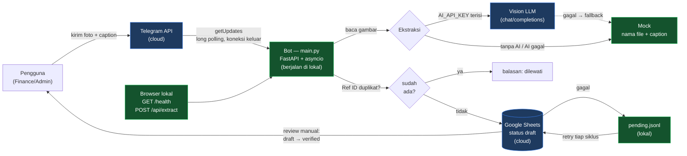

# Bot Pencatatan Transaksi — Milestone 1: Telegram → Ekstraksi → Google Sheets

Bot Telegram terima foto/screenshot bukti transaksi → ekstraksi field → append ke Google Sheets (status `draft`, review manual di Sheet). Tanpa database.

Deploy aktif: https://ai-finance-assistant-z473.onrender.com/health — detail di [DEPLOYMENT.md](DEPLOYMENT.md).

## Arsitektur



- Satu proses di lokal: polling Telegram + endpoint API berjalan bersamaan; semua koneksi **keluar** (internet), tanpa server publik.
- Mode vision (AI) dipakai bila `AI_API_KEY` ada; selalu fallback ke mock agar alur tidak pernah putus.
- Sheets = tujuan akhir (append-only); `pending.jsonl` = penahan gagal, bukan penyimpanan utama.

## Setup

```bash
cd bot
python3 -m venv .venv && source .venv/bin/activate
pip install -r requirements.txt
cp .env.example .env        # lalu isi
python main.py              # server di http://127.0.0.1:8000
```

Isi `.env` minimal:

1. `TELEGRAM_BOT_TOKEN` — dari @BotFather.
2. `TELEGRAM_ALLOWED_CHAT_IDS` — chat_id pengguna yang boleh (cek via @userinfobot), pisahkan koma.

## Setup Google Sheets (service account)

Gratis, tanpa billing, sekali setup (~5 menit), kunci tidak kedaluwarsa.

1. **Buat project** — https://console.cloud.google.com → dropdown project → **New Project** → Create.
2. **Aktifkan API** — menu **APIs & Services** → **Library** → cari "Google Sheets API" → **Enable**.
3. **Buat service account** — **APIs & Services** → **Credentials** → **Create Credentials** → **Service account** → nama bebas → Create and Continue → skip role → **Done**.
4. **Unduh kunci** — klik akun yang baru dibuat → tab **Keys** → **Add Key** → **Create new key** → **JSON**.
5. **Pasang ke project**:
   ```bash
   cp ~/Downloads/<file>.json service_account.json   # sudah masuk .gitignore
   ```
6. **Ambil email service account**:
   ```bash
   .venv/bin/python -c "import json;print(json.load(open('service_account.json'))['client_email'])"
   ```
7. **Siapkan Sheet** — buat Sheet baru (kas Operasional) → **Share** → tempel email service account → role **Editor** → centang "Don't send". Salin **Spreadsheet ID** dari URL `docs.google.com/spreadsheet/d/`**`ID`**`/edit`.
8. **Isi `.env`**:
   ```
   GOOGLE_SPREADSHEET_ID=<ID>
   GOOGLE_SERVICE_ACCOUNT_FILE=service_account.json
   ```

Verifikasi: `curl http://127.0.0.1:8000/health` → `"sheets": true`.

Troubleshooting: append gagal "insufficient permissions" = email service account (langkah 6) belum dapat akses Editor di Sheet (langkah 7).

Opsional AI: isi `AI_API_KEY` (+ `AI_BASE_URL`/`AI_MODEL` bila pakai provider lain) untuk ekstraksi vision. Tanpa itu = mode mock (tanggal dari nama file, nominal dari caption).

## Alur

- Kirim **foto ke bot dalam satu pesan**, dengan caption (opsional, mis. `Rp195.000 penjualan satvika`). Caption dipakai sebagai konteks ekstraksi **dan** disimpan utuh di kolom `Caption`.
  - Caption yang dikirim sebagai pesan terpisah **tidak** terbaca bot — selalu satu paket foto + caption.
- Mode vision (AI): gambar + caption dikirim bersama ke AI → field diisi AI.
- Mode mock (tanpa AI): gambar tidak dibaca; tanggal dari nama file, nominal/arah dari caption, keterangan = caption.
- Bot ekstrak → append ke Sheet (12 kolom), balasan status. Duplikat (Ref ID sama) dilewati.
- Sheets gagal → antre `pending.jsonl`, retry otomatis tiap siklus polling.
- Review: ubah kolom `Status` `draft` → `verified` setelah dicek. **Angka AI belum dipakai sebelum verified.**

## Skema Sheet (12 kolom)

`Tanggal | Keterangan | Nominal | Arah | Kategori | Status | Sumber File | Ref ID | Confidence | Tanggal Input | Catatan | Caption`

- Header dibuat otomatis saat Sheet kosong; Sheet lama (11 kolom) otomatis ditambah kolom `Caption`.
- `Keterangan` = hasil ekstraksi AI (atau caption di mode mock); `Caption` = teks asli apa adanya.

## Endpoint

- `GET /health` — status telegram/sheets/ai + antrean.
- `POST /api/extract` `{filename, image_base64?, caption?}` — ekstraksi + append tanpa bot (untuk uji cepat/web nanti).

## Antrean Gagal (`pending.jsonl`)

Mekanisme agar ekstraksi tidak hilang ketika Google Sheets tidak bisa dijangkau:

1. **Kapan masuk antrean** — `append_sheet()` gagal (Sheets down, permission salah, kredensial kedaluwarsa, koneksi putus) setelah ekstraksi sukses. Record ditulis ke `pending.jsonl` (1 baris JSON per kejadian) lalu pengguna tetap diberi balasan bahwa ekstraksi berhasil tapi pengiriman ditunda.
2. **Format baris** — hasil ekstraksi lengkap (`tanggal`, `keterangan`, `nominal`, `ref_id`, `caption`, dst.) + `_error` (pesan kegagalan) + `_ts` (epoch).
3. **Kapan dikirim ulang** — `flush_pending()` dipanggil **tiap siklus polling** sebelum `getUpdates` berikutnya. Tiap baris dihapus dari file dulu, lalu dicoba append; gagal lagi → ditulis ulang. Sukses/duplikat → baris hilang dari antrean.
4. **Tidak pernah menggandakan** — retry melewati cek dedupe `Ref ID` yang sama seperti proses normal, jadi meski baris sempat terkirim sebelum error, retry akan berstatus `dup`.
5. **Batas** — file di filesystem proses; **hilang saat redeploy Render** (tidak persisten). Antrean ini penahan kegagalan sementara, bukan penyimpanan. `GET /health` menampilkan `pending: true/false`.

`pending.jsonl` sudah masuk `.gitignore` — tidak pernah ikut ter-commit.

## Batasan (milestone 1)

- Ekstraksi mock tanpa AI = nominal hanya dari caption (gambar tidak dibaca); tanpa caption, kolom `Nominal` kosong.
- Klasifikasi awal kosong (kolom Kategori diisi AI bila vision aktif, sisanya manual).
- Belum ada balancing (milestone 2) dan tanya-jawab (milestone 3).

## Pengembangan Berikutnya

Urutkan berdasarkan nilai buat brief (3 pilihan kelompok) dan usaha:

1. **Balancing (inti Pilihan 1)** — baca mutasi bank (PDF/XLSX) → cocokkan baris Sheet via Ref ID/tanggal+nominal → status `cocok` / `belum cocok` / `tercatat di kas tapi tidak di mutasi` + laporan selisih per periode.
2. **Web app baru (rekap/PnL)** — bangun dari awal, membaca Sheet yang sama via service account → rekap harian + draf PnL dari data bot.
3. **Tanya-jawab & ringkasan (Pilihan 3)** — command bot (`/total Januari`) → query kode → angka dari kode, LLM hanya merangkai kalimat, jawaban wajib menunjuk baris sumber.
4. **Kualitas** — pytest (extract/dedupe/pending), eval 10 foto sampel → bahan EV-xx Testing Report.
5. **Integrasi lanjutan bila waktu cukup** — klasifikasi kategori otomatis (rule/Jev), command `/rekap`, ekstraksi invoice PDF, multi-kas, deploy always-on.

Yang tidak perlu dibangun: database, login, dashboard analytics, n8n.

### Catatan desain terbuka (dipelajari nanti)

- **Balasan ack "sedang diproses"** — saat ini foto yang diproses tidak dibalas sampai selesai (ekstraksi bisa 10–60 detik, user menunggu tanpa kabar). Rencana: kirim `⏳ Diterima, sedang diproses…` segera setelah lolos whitelist, **sebelum** unduh file/ekstraksi, lalu pesan hasil seperti sekarang (✅/♻️/⚠️/❌). Kegagalan kirim ack diabaikan agar tidak mematikan proses. Pertimbangan UX: menurunkan risiko user kirim ulang karena mengira gagal, dan memenuhi UN-01 (kepastian transaksi diterima). Bentuk sederhana: dua bubble terpisah; opsi lanjut: edit pesan ack menjadi hasil akhir.
- **Ref ID prioritas nomor referensi dokumen** — `Ref ID` saat ini selalu diisi `tg:<file_unique_id>` sehingga nomor referensi hasil ekstraksi (`rec["ref"]`) terbuang. Rencana: `ref_id = f"doc:{rec['ref']}"` bila ada, fallback `tg:<file_unique_id>`. Alasan: nomor referensi bank unik per transaksi → deteksi duplikat lebih kuat (foto diedit/kompresi ulang tetap ketangkap) dan menjadi kunci pencocokan untuk balancing (milestone 2) terhadap kolom referensi di mutasi bank. Format prefix `doc:`/`tg:` ditentukan sejak awal dan tidak diubah-ubah.
- **Google Drive sebagai penyimpanan bukti transfer** — setiap foto yang diterima diunggah ke Drive (folder per periode) sehingga baris di Sheet bisa menautkan langsung ke gambar asli saat verifikasi (memenuhi UC-02 "bandingkan dengan gambar via tautan") dan menjadi arsip bukti. Kandidat: `google-api-python-client` dengan service account yang sama. Belum diimplementasikan.
- **PostgreSQL sebagai basis data** — menyimpan nilai hasil ekstraksi (sebelum koreksi) dan nilai final (setelah verifikasi) agar akurasi sistem dapat diukur secara terprogram (bahan SC-01/SC-02 & Testing Report), terpisah dari Sheet yang menjadi tempat kerja harian. Belum diimplementasikan; alternatif ringan bila kebutuhan hanya penyimpanan satu-periode: SQLite 1 file.
- **Nama admin otomatis** — tambah kolom `Nama Admin` diisi dari data pengirim Telegram (`message.from`: `first_name` + `last_name`, fallback `username`, terakhir `"Tidak diketahui"`) — menggantikan kolom "Tanggal Input dan Nama Admin" gaya Cash Report perusahaan. Pertimbangan: nama bergantung pada akun pengirim (bukan selalu orang yang sama dengan yang menginput).
- **Multi-sheet per periode** — Sheet Tujuan ditentukan dari tanggal ekstraksi (`YYYY-MM` → sheet/bulan). Sebelum append: cek apakah sheet periode ada.
  - Ada → pakai.
  - Belum ada → **buat sheet baru otomatis** (`add_worksheet("Nov 2026")` + header), atau fallback ke sheet umum + kolom `Periode` bila otomatis dinilai berisiko.
  - Dedupe Ref ID wajib **per sheet** (col_values dibaca dari sheet tujuan, bukan sheet pertama).
  - Alternatif sederhana: 1 spreadsheet berisi banyak tab bulanan (bukan banyak file) — disarankan, karena share service account cukup 1 kali.
