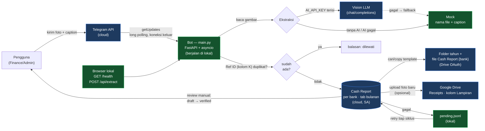

# Bot Pencatatan Transaksi — Milestone 1: Telegram → Ekstraksi → Cash Report

Bot Telegram terima foto/screenshot bukti transaksi → ekstraksi field → tulis ke **Cash Report** (Google Sheets per bank per tahun, tab bulanan, status `draft`, review manual). Tanpa database.

Deploy aktif: https://ai-finance-assistant-z473.onrender.com/health — detail di [DEPLOYMENT.md](DEPLOYMENT.md).

## Arsitektur



- Satu proses di lokal: polling Telegram + endpoint API berjalan bersamaan; semua koneksi **keluar** (internet), tanpa server publik.
- Mode vision (AI) dipakai bila `AI_API_KEY` ada; selalu fallback ke mock agar alur tidak pernah putus.
- **Split kredensial**: Drive (cari folder, copy template, upload foto) = OAuth user; sel/tab Cash Report = service account. `pending.jsonl` = penahan gagal, bukan penyimpanan utama.

## Setup

```bash
cd bot
python3 -m venv .venv && source .venv/bin/activate
pip install -r requirements.txt
cp .env.example .env        # lalu isi
python main.py              # server di http://127.0.0.1:8000
```

Isi `.env` minimal:

1. `TELEGRAM_BOT_TOKEN` — dari @BotFather.
2. `TELEGRAM_ALLOWED_CHAT_IDS` — chat_id pengguna yang boleh (cek via @userinfobot), pisahkan koma.

## Setup Google Sheets (service account)

Gratis, tanpa billing, sekali setup (~5 menit), kunci tidak kedaluwarsa.

1. **Buat project** — https://console.cloud.google.com → dropdown project → **New Project** → Create.
2. **Aktifkan API** — menu **APIs & Services** → **Library** → cari "Google Sheets API" → **Enable**.
3. **Buat service account** — **APIs & Services** → **Credentials** → **Create Credentials** → **Service account** → nama bebas → Create and Continue → skip role → **Done**.
4. **Unduh kunci** — klik akun yang baru dibuat → tab **Keys** → **Add Key** → **Create new key** → **JSON**.
5. **Pasang ke project**:
   ```bash
   cp ~/Downloads/<file>.json service_account.json   # sudah masuk .gitignore
   ```
6. **Ambil email service account**:
   ```bash
   .venv/bin/python -c "import json;print(json.load(open('service_account.json'))['client_email'])"
   ```
7. **Siapkan folder Cash Report & share ke SA** — buat folder `Cash Report` di Drive → **Share** → tempel email service account (langkah 6) → role **Editor** → centang "Don't send". *(Semua file yang kelak dibuat di dalamnya — folder tahun, file per bank — mewarisi izin ini.)*
8. **Isi `.env`**:
   ```
   GOOGLE_SERVICE_ACCOUNT_FILE=service_account.json
   CASH_REPORT_FOLDER_ID=<ID folder Cash Report>
   CASH_REPORT_TEMPLATE_ID=<ID spreadsheet template>
   ```

Verifikasi: `curl http://127.0.0.1:8000/health` → `"sheets": true`.

Troubleshooting: append gagal "insufficient permissions" = email service account (langkah 6) belum dapat akses Editor di folder (langkah 7).

Opsional AI: isi `AI_API_KEY` (+ `AI_BASE_URL`/`AI_MODEL` bila pakai provider lain) untuk ekstraksi vision. Tanpa itu = mode mock (tanggal dari nama file, nominal dari caption).

## Setup Cash Report (folder, template, verifikasi)

Struktur yang dipakai bot (lihat juga `cash_report/README.md`):

```
Google Drive/
├── Cash Report/
│   ├── Spreadsheet Template Cash Report   ← CASH_REPORT_TEMPLATE_ID
│   └── <tahun>/                           ← otomatis (folder tahun)
│       └── Cash Report {BANK}             ← otomatis (copy template)
└── Receipts/                              ← GOOGLE_DRIVE_FOLDER_ID (upload foto)
```

Aturan **template** (wajib dipenuhi):

- Google Sheet, berisi 12 tab `Cash Report - <Bulan> 2025` + tab `config` (tahun template = `CR_TEMPLATE_YEAR`, default `2025`).
- Header tabel di **baris 5**; `Saldo Awal` baris 6; data mulai baris 7; ada baris **`Sub Total`** (kolom B, bebas huruf besar/kecil) dengan `Sisa Saldo` dan `Grand Total` di bawahnya.
- Kolom A–J format perusahaan; kolom K–P (**Ref ID, Status, Confidence, Caption, Catatan, Sumber File**) ditambah otomatis bot (grid diperluas 10→16, header ditulis di K5:P5 bila kosong).
- Rumus bawaan template yang dihormati bot: saldo `=I_prev+G−H`, `SUM(G/H)` di Sub Total — hanya ditulis ulang saat bot menyisipkan baris.

Verifikasi setup (baca saja, tidak menulis):

```bash
.venv/bin/python cash_report/verify_setup.py
```

Menampilkan: share SA ✓, daftar tab, tab bulan hilang, tab config, baris Sub Total, header tahun, formula E/F/G/H, dan isi baris 5–7.

## Setup Google Drive (opsional — arsip bukti transfer)

Foto yang diterima juga diunggah ke Google Drive (folder `Receipts`); tautannya ditulis ke kolom **Lampiran (J)** supaya bisa dibuka langsung dari Cash Report (memenuhi UC-02). Fitur ini **opsional** — tanpa konfigurasi, bot tetap jalan normal.

Upload & manajemen file memakai **OAuth akun user** (bukan service account): Google memblokir service account membuat file sendiri (error `storageQuotaExceeded`). Scope yang dipakai **`https://www.googleapis.com/auth/drive`** (penuh) — diperlukan untuk mencari folder tahun dan menyalin template milik user. **Token lama ber-scopes `drive.file` tidak berlaku untuk fitur ini — buat ulang refresh token (langkah 4).**

1. **Aktifkan Drive API** — Google Cloud Console → **APIs & Services** → **Library** → cari "Google Drive API" → **Enable**.
2. **OAuth consent screen** — **APIs & Services** → **OAuth consent screen** → User Type **External** → isi app name/email → **Save** → tab **Audience/Testing** → **+ Add users** → tambahkan Gmail yang akan jadi pemilik foto (mode Testing cukup, tidak perlu verifikasi Google).
3. **Buat OAuth client** — **Credentials** → **Create Credentials** → **OAuth client ID** → Application type **Desktop app** → Create → **Download JSON** → simpan sebagai `credentials.json` di folder `bot/` (sudah masuk `.gitignore`).
4. **Ambil refresh token (sekali saja)** — jalankan dua perintah ini. Perhatian: baris penutup `PY` harus **tepat di kolom paling kiri** (tanpa spasi); kalau terminal menampilkan prompt `>` terus, ketik `PY` lalu Enter.

```bash
.venv/bin/pip install google-auth-oauthlib   # sudah di requirements.txt
.venv/bin/python - <<'PY'
from google_auth_oauthlib.flow import InstalledAppFlow
flow = InstalledAppFlow.from_client_secrets_file(
    "credentials.json", ["https://www.googleapis.com/auth/drive"])
creds = flow.run_local_server(port=0)
print("REFRESH_TOKEN=" + creds.refresh_token)
PY
```

   Browser terbuka → login Gmail tujuan → izinkan → salin nilai `REFRESH_TOKEN` dari terminal.
5. **Buat folder tujuan** — di Drive akun yang sama, mis. `Receipts 2026` → salin **Folder ID** dari URL `drive.google.com/drive/folders/`**`ID`**. *(Tidak perlu share — file nanti milik akun ini.)*
6. **Isi `.env`**:
   ```
   GOOGLE_OAUTH_CLIENT_ID=<client id dari langkah 3>
   GOOGLE_OAUTH_CLIENT_SECRET=<client secret>
   GOOGLE_OAUTH_REFRESH_TOKEN=<nilai langkah 4>
   GOOGLE_DRIVE_FOLDER_ID=<folder id langkah 5>
   ```
   Di Render: sama di Dashboard Environment.

Verifikasi: `/health` → `"drive": true`; kirim foto → balasan ada tautan "Bukti transfer" dan baris Cash Report punya isi kolom Lampiran.

Catatan: unggahan hanya terjadi untuk baris **baru** (duplikat dilewati), dan hanya bila tulis Cash Report sukses. Gagal unggah Drive tidak mematikan proses — kolom dibiarkan kosong, error muncul di log. Refresh token tidak kedaluwarsa selama tidak dicabut (atau password Gmail diganti).

## Alur

- Kirim **foto ke bot dalam satu pesan**, dengan caption (opsional, mis. `Rp195.000 penjualan satvika`). Caption dipakai sebagai konteks ekstraksi **dan** disimpan utuh di kolom `Caption`.
  - Caption yang dikirim sebagai pesan terpisah **tidak** terbaca bot — selalu satu paket foto + caption.
- Mode vision (AI): gambar + caption dikirim bersama ke AI → field diisi AI (termasuk `bank` → menentukan file Cash Report tujuan; kosong → `CR_DEFAULT_BANK`).
- Mode mock (tanpa AI): gambar tidak dibaca; tanggal dari nama file, nominal/arah dari caption, keterangan = caption.
- Bot ekstrak → **pipeline Cash Report**: folder tahun (buat bila perlu) → file `Cash Report {bank}` (copy template bila baru, tahun di-rename) → tab bulanan → cek duplikat (Ref ID, kolom K) → upload foto ke Receipts → tulis baris A–P → balasan status + tautan bukti.
- Tab bulanan tidak ada (nama salah/hilang) atau tulis gagal → antre `pending.jsonl`, retry otomatis tiap siklus polling.
- Review: ubah kolom `Status` (L) `draft` → `verified` setelah dicek. **Angka AI belum dipakai sebelum verified.**

## Skema kolom Cash Report (A–P)

Format perusahaan A–J + kolom audit K–P (ditambah otomatis):

| Kolom | Isi | Aturan |
|---|---|---|
| A | Tanggal Input | tanggal jam penulisan (Asia/Jakarta) |
| B | Tanggal Transaksi | dari ekstraksi |
| C | Keterangan | caption menang, fallback ekstraksi |
| D | Kategori | dari ekstraksi |
| E, F | Keterangan uang masuk/keluar | **selalu kosong** (format perusahaan) |
| G | Debet | nominal **hanya bila arah = masuk** |
| H | Kredit | nominal **hanya bila arah = keluar** |
| I | Saldo | formula template — tidak ditulis bot |
| J | Lampiran | tautan foto di Drive (kosong bila fitur off/gagal) |
| K | Ref ID | dedupe (`tg:…` / `manual:…`) |
| L | Status | `draft` saat tulis; reviewer → `verified` |
| M | Confidence | hasil ekstraksi |
| N | Caption | teks asli apa adanya |
| O | Catatan | mis. "Ekstraksi AI — wajib ditinjau" |
| P | Sumber File | nama file foto |

- Baris ditulis di baris kosong pertama 7..SubTotal−1; penuh → disisipkan (format & rumus ikut menyesuaikan).
- Query PnL/reconcile nanti **hanya menghitung baris `Status = verified`** dan memakai G/H sebagai angka.

## Endpoint

- `GET /health` — status telegram/sheets/ai/drive + antrean.
- `POST /api/extract` `{filename, image_base64?, caption?}` — ekstraksi + tulis Cash Report tanpa bot (untuk uji cepat/web nanti).

## Antrean Gagal (`pending.jsonl`)

Mekanisme agar ekstraksi tidak hilang ketika Drive/Sheets tidak bisa dijangkau:

1. **Kapan masuk antrean** — `write_cash_report()` gagal (folder/template tidak ada, permission salah, kredensial kedaluwarsa, koneksi putus) setelah ekstraksi sukses. Record ditulis ke `pending.jsonl` (1 baris JSON per kejadian) lalu pengguna tetap diberi balasan bahwa ekstraksi berhasil tapi pengiriman ditunda.
2. **Format baris** — hasil ekstraksi lengkap (`tanggal`, `keterangan`, `nominal`, `arah`, `bank`, `ref_id`, `caption`, dst.) + `_error` (pesan kegagalan) + `_ts` (epoch).
3. **Kapan dikirim ulang** — `flush_pending()` dipanggil **tiap siklus polling** sebelum `getUpdates` berikutnya. Tiap baris dihapus dari file dulu, lalu dicoba tulis; gagal lagi → ditulis ulang. Sukses/duplikat → baris hilang dari antrean.
4. **Tidak pernah menggandakan** — retry melewati cek dedupe `Ref ID` (kolom K) yang sama seperti proses normal, jadi meski baris sempat terkirim sebelum error, retry akan berstatus `dup`. Retry **tanpa gambar** (file foto tidak ikut antrean) → kolom Lampiran kosong — cukup isi manual atau kirim ulang foto untuk baris yang belum ada.
5. **Batas** — file di filesystem proses; **hilang saat redeploy Render** (tidak persisten). Antrean ini penahan kegagalan sementara, bukan penyimpanan. `GET /health` menampilkan `pending: true/false`.

`pending.jsonl` sudah masuk `.gitignore` — tidak pernah ikut ter-commit.

## Batasan (milestone 1)

- Ekstraksi mock tanpa AI = nominal hanya dari caption (gambar tidak dibaca); tanpa caption, kolom `Nominal` kosong.
- Klasifikasi awal kosong (kolom Kategori diisi AI bila vision aktif, sisanya manual).
- Belum ada balancing (milestone 2) dan tanya-jawab (milestone 3).

## Pengembangan Berikutnya

Urutkan berdasarkan nilai buat brief (3 pilihan kelompok) dan usaha:

1. **Balancing (inti Pilihan 1)** — baca mutasi bank (PDF/XLSX) → cocokkan baris Sheet via Ref ID/tanggal+nominal → status `cocok` / `belum cocok` / `tercatat di kas tapi tidak di mutasi` + laporan selisih per periode.
2. **Web app baru (rekap/PnL)** — bangun dari awal, membaca Sheet yang sama via service account → rekap harian + draf PnL dari data bot.
3. **Tanya-jawab & ringkasan (Pilihan 3)** — command bot (`/total Januari`) → query kode → angka dari kode, LLM hanya merangkai kalimat, jawaban wajib menunjuk baris sumber. Rancangan lengkapnya di bagian **Rancangan Tanya-Jawab & Data**.
4. **Kualitas** — pytest (extract/dedupe/pending), eval 10 foto sampel → bahan EV-xx Testing Report.
5. **Integrasi lanjutan bila waktu cukup** — klasifikasi kategori otomatis (rule/Jev), command `/rekap`, ekstraksi invoice PDF, multi-kas, deploy always-on.

Yang tidak perlu dibangun: database, login, dashboard analytics, n8n.

## Rancangan Tanya-Jawab & Data (hasil diskusi desain)

Keputusan inti: **tanpa database untuk query AI** — Sheet tetap satu-satunya source of truth.

### Query AI baca Sheet langsung, bukan mirror DB

Data diedit manual di Sheet (draft → verified); mirror DB akan jadi basi dan menimbulkan masalah sync yang justru dihindari. Volume kecil → baca via `gspread` saat query juga cukup. Bentuknya **tools**, bukan database:

| Tool | Fungsi |
|---|---|
| `aggregate(period, arah, kategori?)` | total masuk/keluar — dihitung **kode** |
| `list_rows(period, filter?)` | daftar baris untuk pertanyaan rinci |
| `get_receipt(ref_id)` | ambil tautan foto dari kolom Lampiran (J) (read-only) |

Aturan tetap: AI hanya menerjemahkan intent → parameter dan menyusun narasi; jawaban wajib menyebut sumber (tab/baris).

### PnL & reconcile: cukup spreadsheet

- **PnL**: baca → agregasi per kategori di kode (sudah dibuktikan prototipe).
- **Reconcile**: matching *in-memory* antara transaksi Sheet dan **tab `Mutasi`** (hasil parse PDF/XLSX disimpan sekali — jangan parse ulang tiap run) → hasil ditulis ke kolom (`Status Reconcile`, `Cocok Dengan`, `Selisih`) + laporan selisih per periode.
- **Database hanya kalau**: butuh log nilai AI vs final (sebelum koreksi vs setelah verifikasi) untuk mengukur akurasi — bahan SC-01/SC-02 & Testing Report — dengan **SQLite** append-only, atau baris > ~100rb / multi-penulis → **PostgreSQL**. Sinkron **satu arah Sheet → DB**, tidak pernah dua arah.

### Routing pesan: foto vs tanya-data

- Foto/dokumen → jalur ekstraksi **tidak berubah** dan tidak pernah melewati LLM (cukup cek tipe pesan).
- Teks → berurutan: (1) command `/` dulu (gratis, deterministik); (2) bahasa bebas → **satu panggilan LLM tool-calling** — pilihan tool-nya *adalah* routing-nya. Classifier terpisah tidak direkomendasikan (berarti dua panggilan AI per pertanyaan: lambat, mahal, dua titik gagal).
- Klasifikasi gagal / AI mati → balasan bantuan (fallback, pola sama dengan mode mock).

### Command `/` — opsional, parameter divalidasi

- Tidak wajib; disarankan untuk pola berulang: `/total Nov`, `/rekap`, `/help`.
- Parameter tidak valid → balas **usage singkat dengan contoh**, tidak pernah exception:
  - `/total` atau `/total abc` → `Format: /total <bulan> — contoh: /total Nov, /total 2026-11`
  - command tidak dikenal → ringkasan bantuan.
- `first = text.split()[0].split("@")[0]` (buang `@botname` di grup) → lookup dict handler → parse argumen di dalam handler.

### Catatan desain (belum diimplementasi)

- **Balasan ack "sedang diproses"** — saat ini foto yang diproses tidak dibalas sampai selesai (ekstraksi bisa 10–60 detik, user menunggu tanpa kabar). Rencana: kirim `⏳ Diterima, sedang diproses…` segera setelah lolos whitelist, **sebelum** unduh file/ekstraksi, lalu pesan hasil seperti sekarang (✅/♻️/⚠️/❌). Kegagalan kirim ack diabaikan agar tidak mematikan proses. Pertimbangan UX: menurunkan risiko user kirim ulang karena mengira gagal, dan memenuhi UN-01 (kepastian transaksi diterima). Bentuk sederhana: dua bubble terpisah; opsi lanjut: edit pesan ack menjadi hasil akhir.
- **Ref ID prioritas nomor referensi dokumen** — `Ref ID` saat ini selalu diisi `tg:<file_unique_id>` sehingga nomor referensi hasil ekstraksi (`rec["ref"]`) terbuang. Rencana: `ref_id = f"doc:{rec['ref']}"` bila ada, fallback `tg:<file_unique_id>`. Alasan: nomor referensi bank unik per transaksi → deteksi duplikat lebih kuat (foto diedit/kompresi ulang tetap ketangkap) dan menjadi kunci pencocokan untuk balancing (milestone 2) terhadap kolom referensi di mutasi bank. Format prefix `doc:`/`tg:` ditentukan sejak awal dan tidak diubah-ubah.
- **Google Drive sebagai penyimpanan bukti transfer** — sudah diimplementasikan (lihat "Setup Google Drive"): folder `Receipts` + kolom Lampiran (J). Yang belum: **folder per periode** (`Receipts 2026/01`) supaya arsip terpisah per bulan.
- **Nama admin otomatis** — tambah kolom `Nama Admin` diisi dari data pengirim Telegram (`message.from`: `first_name` + `last_name`, fallback `username`, terakhir `"Tidak diketahui"`) — menggantikan kolom "Tanggal Input dan Nama Admin" gaya Cash Report perusahaan. Pertimbangan: nama bergantung pada akun pengirim (bukan selalu orang yang sama dengan yang menginput).
- **Multi-sheet per periode** — **sudah sebagian lewat struktur Cash Report**: file per bank per tahun, tab per bulan, dedupe Ref ID per tab (`col_values` dibaca dari tab tujuan). Yang belum: **buat tab bulan otomatis** bila tidak ada (sekarang error `Worksheet tidak ditemukan`) — berguna bila template tidak lengkap 12 bulan.
